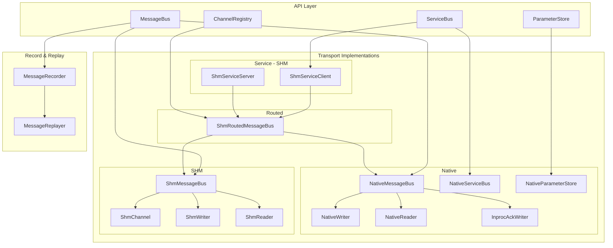
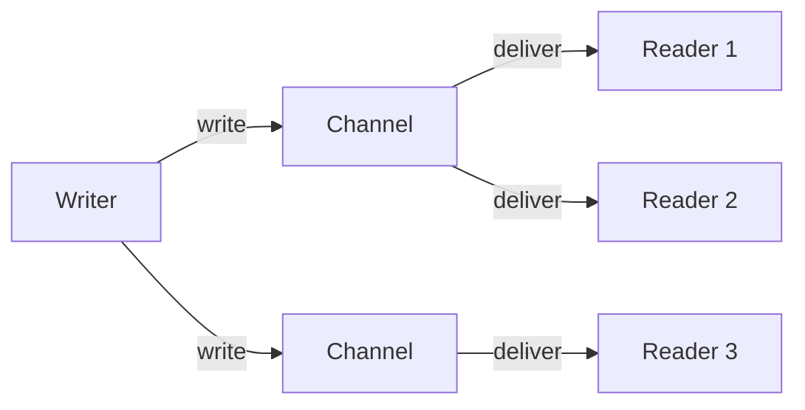
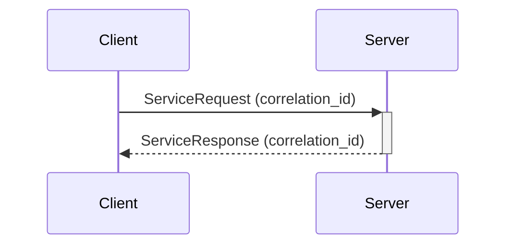
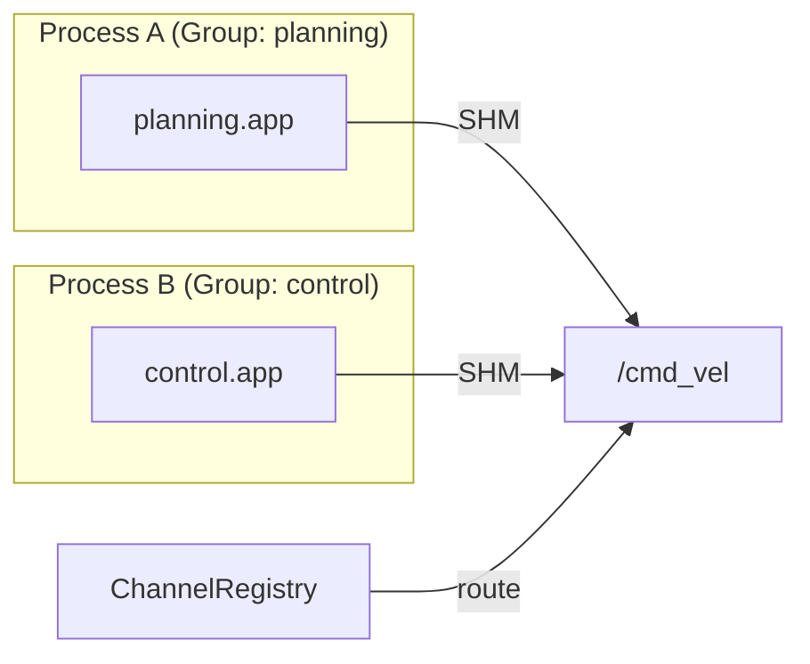

# Transport 层架构规范

#### 文档版本

- 版本：v0.3.1
- 更新日期：2026-04-13
- 状态：已定稿

***

## 1. 设计目标

Transport 层是 Starletto 的核心通信基础设施，负责：

- **Stream 通信**：1:N 发布订阅模式，用于传感器数据、控制指令等高频流式数据
- **RPC 通信**：1:1 请求响应模式，用于服务调用、参数查询等同步交互
- **跨进程通信**：通过共享内存（SHM）实现零拷贝进程间通信
- **参数存储**：进程内 key-value 参数管理

***

## 2. 核心概念

### 2.1 Channel（通道）

Channel 是逻辑上的数据传输通道，类似于 ROS2 的 Topic 或 DDS 的 DataWriter/DataReader 主题。

```cpp
struct ChannelDescriptor {
    std::string name;              // 通道名称，唯一标识
    std::string type_name;         // 类型全名
    star::schema::SchemaTypeId schema_type_id;  // Schema ID
    ChannelOptions options;         // 通道选项
};

struct ChannelOptions {
    uint32_t depth{0};             // 历史消息队列深度
    DropPolicy drop_policy{DropPolicy::KEEP_LAST};  // 队列满时丢弃策略
    bool reliable{false};         // 是否需要可靠传输（ACK）
    int64_t ack_timeout_ms{0};     // ACK 超时时间
};
```

**QoS 语义**：

- `depth > 0`：启用历史消息队列，新订阅者可获取最近 `depth` 条消息
- `drop_policy = KEEP_LAST`：队列满时丢弃最新消息，保留旧消息
- `drop_policy = DROP_NEWEST`：队列满时丢弃最新消息

### 2.2 Port（端口）

Port 是 Component 的输入输出端点，用于描述 Component 与外部的连接关系：

```cpp
struct Port {
    std::string component_name;   // 所属组件名
    std::string port_name;        // 端口名
    bool is_input{true};          // true=输入，false=输出
};
```

### 2.3 通信模式

| 模式         | 语义   | Writer:Reader | 可靠性 | 典型场景       |
| ---------- | ---- | ------------- | --- | ---------- |
| **Stream** | 发布订阅 | 1:N           | 可配置 | 传感器数据、控制指令 |
| **RPC**    | 请求响应 | 1:1           | 可靠  | 服务调用、参数查询  |

***

## 3. 架构图



***

## 4. 目录结构

```
basement/transport/
├── api/
│   ├── message_bus.h         # 核心接口定义
│   ├── service_bus.h         # RPC 接口定义
│   ├── channel_registry.h    # 通道注册表
│   └── parameter_store.h     # 参数存储接口
├── native/
│   ├── native_message_bus.h   # 进程内 MessageBus 实现
│   ├── native_writer.h       # 本地写入器
│   ├── native_reader.h       # 本地读取器
│   └── native_parameter_store.h  # 本地参数存储
├── shm/
│   ├── shm_message_bus.h     # 共享内存 MessageBus 实现
│   ├── shm_channel.h         # 共享内存环形缓冲区
│   ├── shm_views.h           # SHM 视图类型
│   ├── shm_routed_message_bus.h  # 路由消息总线
│   └── shm_service_bus.h     # SHM RPC 实现
└── record/
    ├── message_recorder.h   # 消息录制
    └── message_replayer.h    # 消息回放
```

**注意**：`NativeServiceBus` 定义在 `runtime/factory/runtime_factory.h` 中，是进程内直接调用的 Service 实现。

***

## 5. 核心接口

### 5.1 MessageBus

```cpp
class MessageBus {
    virtual void declare_channel(const ChannelDescriptor& descriptor) = 0;
    virtual auto create_writer(const ChannelDescriptor& descriptor) -> std::shared_ptr<Writer> = 0;
    virtual auto create_reader(const ChannelDescriptor& descriptor, Reader::Callback callback) -> std::shared_ptr<Reader> = 0;
    virtual auto create_ack_writer(const ChannelDescriptor& descriptor) -> std::shared_ptr<AckWriter> = 0;
    virtual auto dump_stats_lines() const -> std::vector<std::string> = 0;
    virtual auto declared_channels() const -> std::vector<std::string> = 0;
    virtual void enable_recorder(const std::string& file_path) = 0;
    virtual void enable_record_channel(const std::string& channel) = 0;
};
```

### 5.2 Writer / AckWriter

```cpp
class Writer {
    virtual void write(const MessageView& message) = 0;
};

class AckWriter : public Writer {
    void write(const MessageView& message) override = 0;
    virtual auto write_with_ack(const MessageView& message, int64_t timeout_ms)
        -> std::future<AckResult> = 0;
    virtual void set_timeout_callback(TimeoutCallback cb) = 0;
};

struct MessageView {
    star::base::TypedConstPtr data;
    star::schema::SchemaTypeId schema_type_id;
    std::function<std::vector<uint8_t>()> encode_binary;
    uint64_t correlation_id{0};
};
```

### 5.3 Reader

```cpp
class Reader {
  public:
    using Callback = std::function<void(const MessageView&)>;
    virtual ~Reader() = default;
};
```

### 5.4 ServiceBus

```cpp
class ServiceBus {
    virtual auto create_client(const ServiceDescriptor& descriptor)
        -> std::shared_ptr<ServiceClient> = 0;
    virtual auto create_server(const ServiceDescriptor& descriptor, Handler handler)
        -> std::shared_ptr<ServiceServer> = 0;
};
```

### 5.5 ParameterStore

```cpp
class ParameterStore {
    virtual auto get(const std::string& key) const -> SchemaValue = 0;
    virtual void set(const std::string& key, const SchemaValue& value) = 0;
    virtual auto list(const std::string& prefix) const -> std::vector<std::string> = 0;
    virtual void flush() = 0;
};
```

***

## 6. ACK 策略

ACK 机制确保消息可靠传输，支持三种模式：

```cpp
struct ChannelOptions {
    bool reliable{false};       // 是否启用可靠传输
    int64_t ack_timeout_ms{0}; // ACK 超时时间
};
```

| reliable | ack\_timeout\_ms | 行为                                  |
| -------- | ---------------- | ----------------------------------- |
| false    | -                | 不等待 ACK，最快投递                        |
| true     | > 0              | 阻塞等待 ACK，超时报错                       |
| true     | = 0              | Fire-and-Forget，接收方仍回复 ACK（用于丢包率统计） |

**实现**：AckWriter 内部使用独立的 ACK 通道（`{channel_name}/ack`）进行确认。

***

## 7. 共享内存（SHM）实现

### 7.1 ShmChannel 环形缓冲区

```
+------------------------------------------+
|              ShmHeader                   |
|  magic | version | seq | notify_seq | ...|
+------------------------------------------+
|  Slot 0  |  Slot 1  |  Slot 2  | Slot 3 |
|  1MB     |   1MB     |   1MB    |  1MB   |
+------------------------------------------+
```

**特性**：

- 4 个 Slot，循环使用
- 每个 Slot 1MB（默认 4MB 总容量）
- Futex 等待/唤醒实现高效同步
- Loan/Commit 模式支持零拷贝

### 7.2 路由决策

`ChannelRegistry` 维护进程组间的路由信息：

```
格式: channel_name|producer_group|consumer_group1,consumer_group2,...
示例: /cmd_vel|planning|control,monitoring
```

**路由决策**：

- `should_publish_shm(channel)`：本地有生产者，且有跨进程消费者
- `should_subscribe_shm(channel)`：本地有消费者，且有跨进程生产者

***

## 8. Stream vs RPC

### 8.1 Stream（发布订阅）



**特点**：

- 1 个 Writer → N 个 Reader
- 异步投递，不等待响应
- 支持 QoS（队列深度、丢弃策略）
- 可选 ACK 确认

### 8.2 RPC（请求响应）



**实现**：内部使用两个 Channel：

- `{service}/request`：请求通道
- `{service}/response`：响应通道

通过 `CorrelationId` 关联请求与响应。

### 8.3 Service 实现对比

| 特性                | NativeServiceBus                          | ShmServiceBus                              |
| ----------------- | ---------------------------------------- | ------------------------------------------ |
| 位置               | runtime/factory/runtime_factory.h          | transport/shm/shm_service_bus.h             |
| 通信方式           | 进程内直接函数调用                         | 基于 MessageBus 的 request/response 通道      |
| 跨进程支持         | ❌                                       | ✅                                         |
| 延迟               | 极低（函数调用）                           | 较高（SHM + 回调）                            |
| Record/Replay     | ❌                                       | ✅（自动通过 MessageBus 录制）                  |

***

## 9. Parameter Store

### 9.1 接口设计

```cpp
class ParameterStore {
    virtual auto get(const std::string& key) const -> SchemaValue = 0;
    virtual void set(const std::string& key, const SchemaValue& value) = 0;
    virtual auto list(const std::string& prefix) const -> std::vector<std::string> = 0;
    virtual void flush() = 0;
};
```

### 9.2 NativeParameterStore 实现

`NativeParameterStore` 是一个纯内存 key-value 存储：

- **线程安全**：使用 `std::mutex` 保护
- **无持久化**：`flush()` 为空操作
- **无跨进程支持**：仅限进程内使用
- **查询支持**：支持前缀匹配的 `list()` 操作

### 9.3 典型使用场景

```cpp
// 设置参数
context->parameter_store().set("control.max_velocity", SchemaValue(10.0));

// 获取参数
auto value = context->parameter_store().get("control.max_velocity");

// 列出所有 control 相关参数
auto keys = context->parameter_store().list("control.");
```

***

## 10. Record & Replay

### 10.1 MessageRecorder

录制指定通道的消息到二进制文件：

```cpp
// 录制所有通道
bus->enable_recorder("/tmp/record.bin");

// 仅录制特定通道
bus->enable_record_channel("/sensor/lidar");

// 录制服务请求/响应（自动支持）
bus->enable_record_channel("/parameter/get/request");
bus->enable_record_channel("/parameter/get/response");
```

**录制格式**：`STARREC` + RecordEntry[]

```cpp
struct RecordEntry {
    int64_t timestamp_ns;
    std::string topic_name;      // 通道名称（包括 service 通道）
    std::string type_name;       // 类型名称
    std::vector<uint8_t> payload; // 二进制 payload
};
```

**Service 通道录制**：Recorder 自动支持录制任何已声明的 channel，包括：
- Stream 通道：`/sensor/lidar`, `/cmd/velocity`
- Service 请求通道：`/parameter/get/request`
- Service 响应通道：`/parameter/get/response`
- ACK 通道：`/sensor/lidar/ack`

### 10.2 MessageReplayer

回放录制的消息，用于仿真和回测。

***

## 11. ChannelRegistry 路由表



**路由格式解析**：

```
输入: "/cmd_vel|planning|control,monitoring"
解析:
  - channel: "/cmd_vel"
  - producer_group: "planning"
  - consumer_groups: ["control", "monitoring"]

含义:
  - planning 进程组生产的 /cmd_vel 消息
  - 需要通过 SHM 投递到 control 和 monitoring 进程组
```

***

## 12. 命名规范

### 12.1 通道命名

| 类型     | 命名格式                    | 示例                                        |
| ------ | ----------------------- | ----------------------------------------- |
| 传感器数据  | `/sensor/{sensor_name}`    | `/sensor/lidar`, `/sensor/camera`         |
| 控制指令   | `/cmd/{module_name}`       | `/cmd/velocity`, `/cmd/trajectory`        |
| 状态反馈   | `/status/{module_name}`    | `/status/planning`, `/status/control`     |
| 服务请求   | `{service}/request`        | `/parameter/get/request`                   |
| 服务响应   | `{service}/response`       | `/parameter/get/response`                  |
| ACK 通道 | `{channel}/ack`            | `/sensor/lidar/ack`                       |

### 12.2 变量命名

| 元素                | 命名风格          | 示例                             |
| ----------------- | ------------- | ------------------------------ |
| 通道名               | snake\_case   | `channel_name`, `sensor_topic` |
| ChannelDescriptor | PascalCase    | `ChannelDescriptor`            |
| ChannelOptions    | PascalCase    | `ChannelOptions`               |
| Port              | PascalCase    | `Port`                         |
| 实现类               | PascalCase    | `NativeMessageBus`             |
| 内部变量              | snake\_case\_ | `channels_`, `readers_`        |

### 12.3 方法命名

| 对象     | 方法                    | 说明         |
| ------ | --------------------- | ---------- |
| Writer  | `write(message)`        | 写入消息       |
| AckWriter | `write_with_ack(msg, ms)` | 带确认写入消息 |
| Reader  | 通过回调接收                 | 无主动方法      |
| MessageBus | `declare_channel(desc)`  | 声明通道       |
| MessageBus | `create_writer(desc)`    | 创建写入器      |
| MessageBus | `create_reader(desc, cb)` | 创建读取器      |

***

## 13. 实现差异对比

| 特性            | NativeMessageBus | ShmMessageBus | ShmRoutedMessageBus |
| ------------- | ---------------- | ------------- | ------------------- |
| 进程内通信         | ✅ 零拷贝            | ✅ 零拷贝         | ✅ 零拷贝               |
| 进程间通信         | ❌                | ✅ 零拷贝         | ✅ 零拷贝               |
| QoS 队列        | ✅                | ✅             | ✅                   |
| ACK 机制        | ✅                | ❌             | ✅ (通过 Native)       |
| 自动路由          | ❌                | ❌             | ✅                   |
| Record/Replay | ✅                | ❌             | ✅ (通过 Native)       |
| Service 支持      | ✅ (NativeServiceBus) | ❌            | ✅ (ShmServiceBus)     |
| Parameter Store | ✅ (NativeParameterStore) | ❌        | ❌                   |

***

## 14. 验收标准

```bash
# 编译验证
./star build

# 运行测试（待实现）
./star test transport

# 验证通道注册
./star run --doctor

# 验证 SHM 通信（多进程）
STAR_PROCESS_GROUP=planning ./star run &
STAR_PROCESS_GROUP=control ./star run &
```

***

## 15. 变更记录

| 版本     | 日期         | 变更内容                                                                                                          |
| ------ | ---------- | --------------------------------------------------------------------------------------------------------------- |
| v0.3.1 | 2026-04-13 | Writer/AckWriter 方法重命名 publish→write；服务通道命名统一为下划线；补充 Parameter Store、Service 实现对比文档；补充 Recorder 服务录制说明 |
| v0.3.0 | 2026-04-13 | 重构：TopicDescriptor → ChannelDescriptor，QoSPolicy → ChannelOptions，删除 EventBus，RouteEntry 重复消除                      |
| v0.2.0 | 2026-04-10 | 新增 ShmRoutedMessageBus，支持跨进程 SHM 路由                                                                     |
| v0.1.0 | 2026-04-01 | 初始版本，基础 MessageBus + ServiceBus                                                                             |
