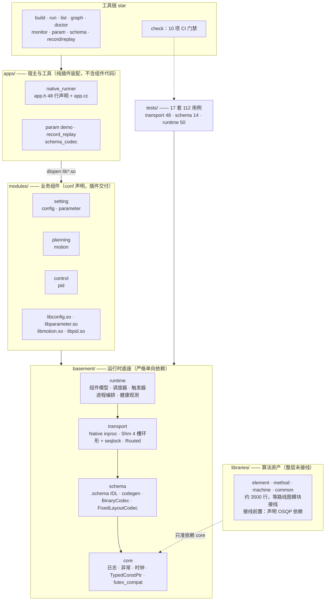
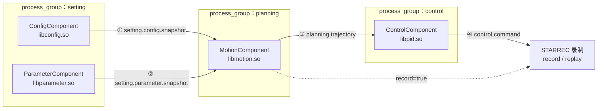
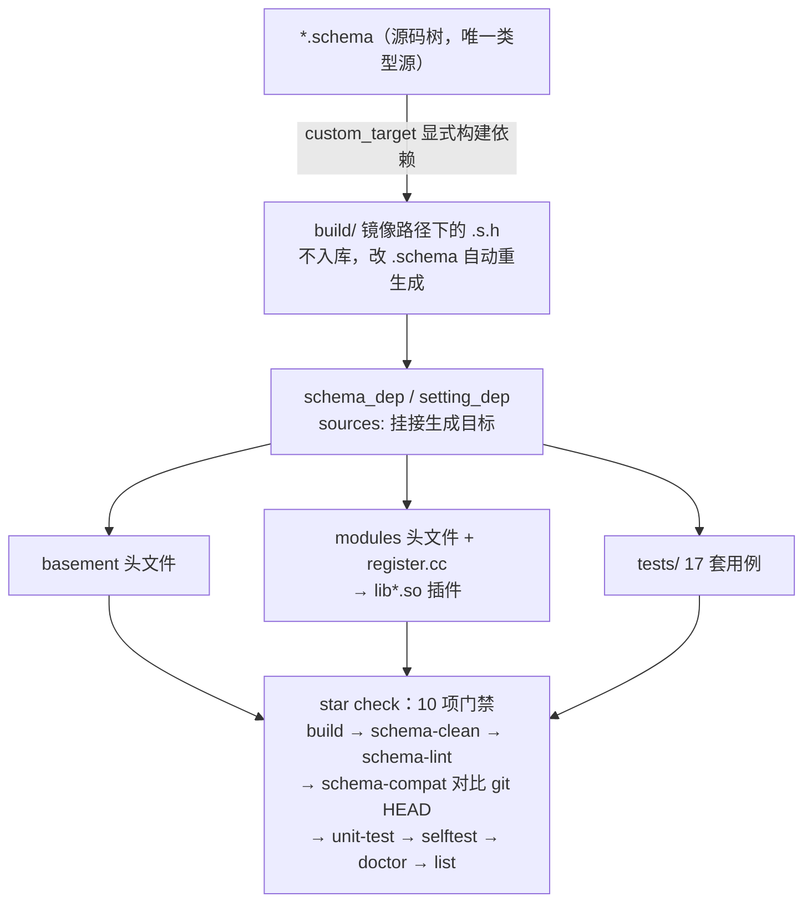

# 系统架构设计

> 2026-09-27 更新：图改用 Mermaid 并对齐本轮整改后的实际状态
> （分层归位、纯插件装配、codegen 迁 custom_target、CI 门禁 10 项）。
> 前置文档：[架构评审与整改](arch_review_20260926.md)。

## 分层架构与依赖方向

分层约束：`libraries` 只依赖 `core`；`runtime` 不定义业务消息；`transport` 不理解业务含义；
`apps` 不包含任何组件实现（配置驱动加载）。

## 数据流（`star run` 真实拓扑，4 组件 4 通道）

投递路径由 `ShmRoutedMessageBus` 自动选路：

- **同 process_group 内**：inproc，`TypedConstPtr` 指针直传，零序列化
- **跨 process_group**：shm，4 槽环形缓冲 loan/view 零拷贝，读侧 seqlock 复核防撕裂；
  SHM 初始化失败自动降级 inproc
- record 标记的通道写入 STARREC 格式，`star replay` 按时间戳回放

## 构建与代码生成流

## 关键设计决策

| 决策 | 选择 | 理由 |
|------|------|------|
| 构建系统 | Meson | `custom_target` 声明 codegen 依赖、跨平台；schema 生成物不入库防漂移 |
| IDL 格式 | 自研 .schema | 零拷贝硬约束，protobuf 不满足 inproc 指针 + shm loan/view 的统一抽象 |
| 代码组织 | Header-only（库层） | 用户偏好 .h 组织；apps 例外（app.h 已拆 app.cc，无 header-only 理由） |
| 组件交付 | conf 声明 + dlopen 插件 | apps 与组件解耦，`doctor --deep` 可校验插件；入口约定 `star_register_components(ComponentRegistry*)` |
| 错误模型 | 运行时状况用状态码 / 编程错误用异常 | 消除「状态码被异常化、又被调度层降级为日志」的反转链 |
| 日志系统 | 自定义宏 + LoggerManager | 零依赖、多 sink 可切换 |
| 进程编排 | fork/exec + 参数传递 | 简单可靠、无需守护进程 |

**关联 spec**：[system_vision.md](spec/system_vision.md)、[basement_design.md](spec/basement_design.md)
