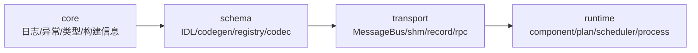

# basement —— 运行时底座

这里是 Starletto 的内核，不依赖 ROS2，也不依赖 `modules/` 或 `apps/`。
所有实现都是 header-only；组件既可以通过 `.so` 动态加载，也可以静态编入
`native_runner_static`（见 [../modules/README.md](../modules/README.md)）。

## 四层与依赖方向



依赖只能向右，不能反向；`basement/` 不 include `modules/`、`apps/`、`libraries/`。

| 层 | 职责 | 入口文档 |
|---|---|---|
| [core](core/README.md) | 基础设施，无业务/传输依赖 | `logger/`、`exception.h`、`type_id.h` |
| [schema](schema/README.md) | `.schema` IDL、Python codegen、类型注册与编解码 | `schema_codegen.py`、`schema_registry.h` |
| [transport](transport/README.md) | 进程内/共享内存传输、录制回放、RPC | `api/message_bus.h`、`shm/` |
| [runtime](runtime/README.md) | 组件生命周期、plan、调度、进程编排、观测 | `component/component.h`、`plan/` |

## 终态约束

- **唯一插件入口**：`star_register_components` + 强制工具链指纹；没有 C ABI/旧入口并存。
- **唯一组件装配路径**：`component.conf` → `auto_configure()`；不保留 `declare_reader/writer`。
- **shm 槽内只接受 v7 带身份帧**；未加帧/损坏帧丢弃并计数。
- **数据版本是功能**：schema 多版本、record v2 读 v1，不属于代码双轨。

## 验证

```bash
./star build
./star test          # 34 套 213 用例
./star check          # 16/16
```

更完整的契约见 [../docs/spec/](../docs/spec/) 与 [../docs/architecture/](../docs/architecture/)。
