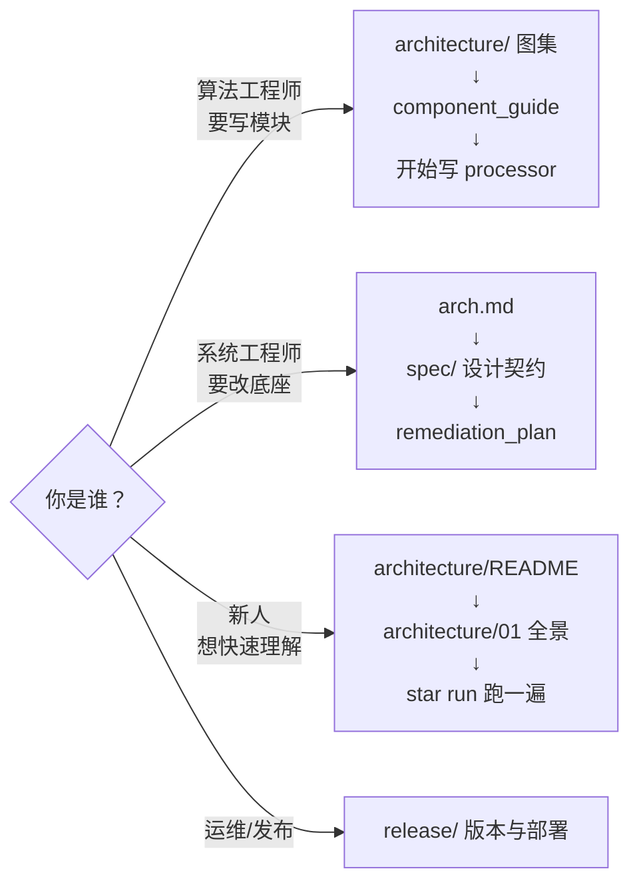

# Starletto 文档

一个 Native-first 自动驾驶运行时：自研类型体系（schema）、共享内存通信（transport）、可预测组件运行时（runtime），主线不依赖 ROS2。

> 通信现状：跨进程走共享内存 + 编码拷贝（帧头携带 schema 身份），
> `ShmSlotView` 的零拷贝读取目前只用于同进程诊断/固定布局视图，不作为跨进程交付承诺。

## 按角色选阅读路径

## 目录

| 路径 | 内容 | 适合谁 |
|---|---|---|
| [`architecture/`](architecture/README.md) | **系统架构图集**（6 篇，面向算法工程师，白话解释进程/内存/通信） | 所有人先看这个 |
| [`component_guide.md`](component_guide.md) | **组件开发指南**：写一个组件要动哪些文件、三重一致性陷阱、易用性改进路线 | 要加模块的人 |
| [`arch.md`](arch.md) | 系统架构（简版，Mermaid 三图 + 关键决策表） | 快速总览 |
| [`spec/`](spec/) | 设计契约：system_vision、basement_design/schema/transport/runtime_*、workplan | 改底座前必读 |
| [`installation.md`](installation.md) | 安装树、源码树外插件开发、pkg-config、C ABI 插件 | 插件作者 |
| [`plugin_abi.md`](plugin_abi.md) | 插件 ABI：C ABI v1（任意 C 编译器）与 C++ header-only 路径、共享库边界 | 插件作者/发布者 |
| [`testing.md`](testing.md) | 测试、确定性随机输入、UBSan/ASan 配方与 CI 模板 | 开发者 |
| [`remediation_plan.md`](remediation_plan.md) | 底层缺陷修复方案（2026-11-11 复审，P0/P1/P2 分级 + 验收） | 系统工程师 |
| [`contract_decisions.md`](contract_decisions.md) | **契约决策（已确认）**：多版本 Schema 演进 + 服务并入通道；实施计划五阶段 | 系统工程师 |
| [`arch_review_20260926.md`](arch_review_20260926.md) | 2026-09 架构评审与整改记录（已完成部分） | 了解历史决策 |
| [`design_change.md`](design_change.md) | 设计变更日志 | 查"为什么这么改" |
| [`release/`](release/) | 版本记录、部署、回滚 | 运维 |
| [`architecture.html`](architecture.html) | 架构网站（单文件，可离线打开） | 演示/分享 |

## 硬约束（改代码前必须知道）

来自 [`spec/basement_design.md`](spec/basement_design.md) §2.2，四条最低标准：

1. **Native-only**：主线不依赖 ROS2；bridge 必须是独立工程。
2. **单进程必须指针传递**：inproc 消息走 `TypedConstPtr`，不序列化。
3. **多进程必须走共享内存**：跨进程经 shm 传输；当前实现是编码后拷贝，
   零拷贝 view 尚未用于跨进程交付（见 P2.2 与 `spec/basement_transport.md`）。
4. **Schema 统一性**：配置、参数、消息、服务共用同一套 `.schema` 与编解码。

## 当前状态（2026-11-14）

| 项 | 状态 |
|---|---|
| 构建 | 0 错误 0 警告（5 类告警提为 `-Werror`） |
| 测试 | 34 套 212 用例 |
| CI 门禁 | `star check` 15/15 |
| 业务模块 | setting/config、setting/parameter、planning/motion（示例）、control/pid |
| 已知缺陷 | 见 [remediation_plan.md](remediation_plan.md)：**P0 六项 + P1 五项已全部修复**；P2 收口；P1.1 B1 安装面、B2 共享库/C ABI、P2.5 macOS 资源采样已完成 |
| 算法资产 | `libraries/` 约 3500 行未接线，等 localization/perception 等模块落地 |
