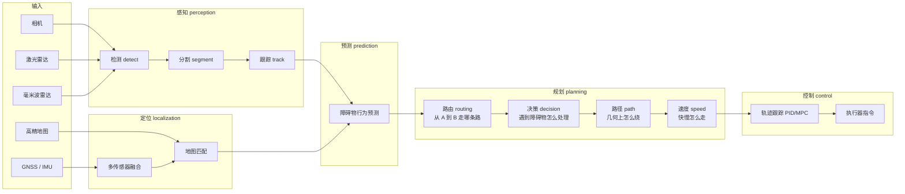
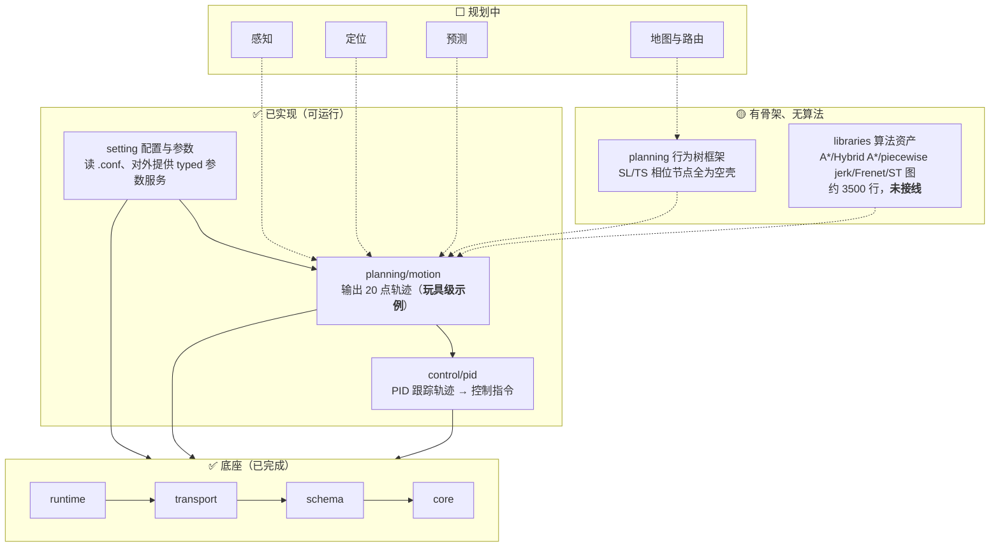
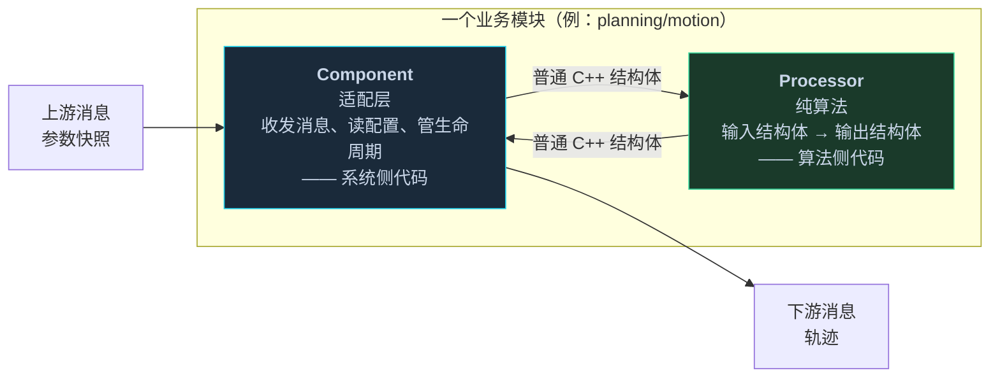

# 01 · 系统全景与当前实现

## 1. 一个完整的自动驾驶系统应该有什么

这张图是**业务形态**：每一格对应一个算法问题。它和 Starletto 无关，任何自动驾驶系统都是这个形状。

## 2. Starletto 当前实现了哪些格

**一句话结论**：底座是工程级完成度，业务是骨架级。`planning/motion` 存在的意义是**演示一个组件该怎么写**，它自己产出的轨迹是正弦扰动的假数据。

## 3. 算法应该写在哪一格

这是对算法工程师最重要的一个问题。每个业务模块内部都分成两半：

- **Processor 是你的地盘**：签名类似 `auto process(const MotionInput&) -> TrajectoryOutput`，纯函数，不碰网络、不碰线程、不碰共享内存，可以离线单元测试。
- **Component 是适配层**：把总线上的消息变成 `MotionInput`，调 Processor，把结果发出去。样板代码多，但模式固定。

> 这条边界是这套系统对算法工程师最重要的承诺：**算法代码零系统依赖**。反过来说，它也是当前易用性痛点的来源——Component 那半边要写的东西不少。详见 [组件开发指南](../component_guide.md)。

## 4. 名词速查（系统侧黑话）

| 词 | 白话解释 | 在 Starletto 里对应 |
|---|---|---|
| **进程 process** | 一个独立运行的程序，有自己独立的内存，进程之间不能直接读对方变量 | `star run --multi-process` 会起多个进程 |
| **线程 thread** | 同一进程内的多条执行流，共享同一份内存 | 调度器 worker、每个订阅者的轮询线程 |
| **通道 channel** | 一条命名的话题，发布者往里写，订阅者从里读 | `/planning/trajectory`、`/control/command` |
| **零拷贝** | 数据只写一次内存，读的一方直接看那块内存，不复制 | 跨进程走 shm；同进程直接传指针 |
| **共享内存 shm** | 一块能被多个进程同时映射的内存 | `/dev/shm` 里的段，4 槽环形缓冲 |
| **插件 plugin** | 编译成独立 `.so` 的代码，运行时才加载进来 | `libmotion.so` 等 4 个 |
| **序列化** | 把内存里的对象变成字节流，才能跨进程/存盘 | `encode_binary` / `from_binary` |
| **QoS** | 投递策略：保留几条、丢了怎么办 | `depth` / `KEEP_LAST` / `DROP_NEWEST` |
