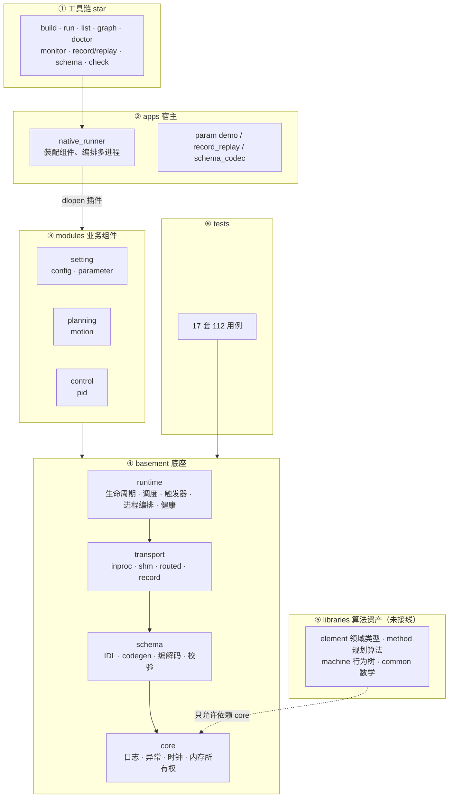
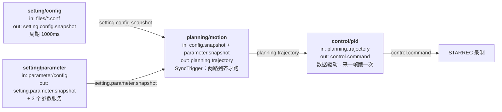
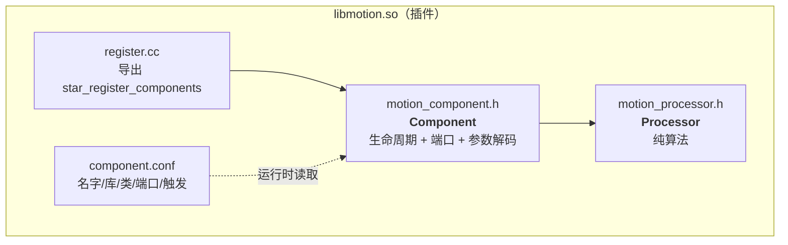
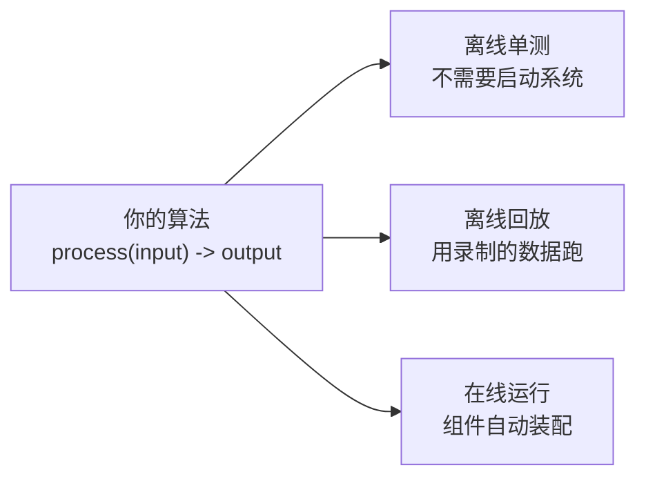

# 02 · 分层与模块职责

## 1. 分层图与依赖方向

**四种依赖关系，规则不同**：

| 关系 | 规则 | 为什么 |
|---|---|---|
| 上层 → 下层 | 允许 | 上层是业务/装配，下层是能力 |
| 下层 → 上层 | **禁止** | 底座不能知道"什么是轨迹" |
| `modules` → `basement` | 允许 | 业务通过 `Component` 基类使用通信能力 |
| `libraries` → `basement` | **只准依赖 `core`** | 算法库必须能在没有通信/运行时的环境里单独编译、单独测试 |

最后一条是硬约束：`libraries` 里的算法如果依赖了 `transport`，就意味着它不能被离线跑、不能在仿真里跑、不能给别的项目复用。

## 2. 每个模块做什么

### 2.1 底座四层（系统侧）

```mermaid
flowchart LR
    subgraph R["runtime"]
        R1["Component 基类<br/>声明端口、收发消息"]
        R2["NativeScheduler<br/>按优先级/周期调度任务"]
        R3["SyncTrigger / TimerTrigger<br/>决定何时跑一次"]
        R4["ProcessOrchestrator<br/>fork/exec 多进程"]
        R5["HealthChecker / ResourceMonitor<br/>健康与资源观测"]
    end
    subgraph T["transport"]
        T1["MessageBus 通道<br/>publish/subscribe"]
        T2["ServiceBus 服务<br/>request/response"]
        T3["Native / Shm / Routed<br/>三套实现"]
        T4["Recorder / Replayer<br/>STARREC 录放"]
    end
    subgraph S["schema"]
        S1[".schema IDL<br/>类型定义"]
        S2["codegen<br/>生成 C++ 类型"]
        S3["BinaryCodec<br/>变长二进制编解码"]
        S4["FixedLayoutCodec<br/>定长布局，供 shm 零拷贝"]
        S5["SchemaRegistry<br/>运行时类型注册表"]
    end
    subgraph C["core"]
        C1["日志 LoggerManager"]
        C2["异常三类语义"]
        C3["TypedConstPtr<br/>类型擦除的智能指针"]
        C4["futex_compat<br/>跨平台等待唤醒"]
        C5["FdGuard"]
    end
    R --> T --> S --> C
```

| 模块 | 负责 | 不负责 |
|---|---|---|
| `core` | 日志、异常分类、类型擦除指针、时钟、fd RAII | 任何业务概念 |
| `schema` | 类型定义与编解码、兼容性检查 | 数据怎么传输 |
| `transport` | 把字节/指针从一个组件送到另一个组件 | 字节里是什么 |
| `runtime` | 什么时候、在哪个线程、装配哪些组件去跑 | 组件内部算法 |

### 2.2 业务模块（当前 4 个组件）

| 组件 | 输入 | 处理 | 输出 | 触发方式 |
|---|---|---|---|---|
| `setting/config` | 5 个 `.conf` 文件 | 解析成 `ConfigSnapshot` | `setting.config.snapshot` | 1000ms 定时 |
| `setting/parameter` | 参数配置文件 | 维护 typed 参数表，响应 get/set/list 服务 | `setting.parameter.snapshot` | 1000ms 定时 |
| `planning/motion` | 上面两个快照 | 读参数 → 生成轨迹（**当前是玩具实现**） | `planning.trajectory` | 两路快照都到齐 |
| `control/pid` | `planning.trajectory` | PID 算油门/刹车/转向 | `control.command`（并录制） | 每来一帧 |

## 3. 一个业务模块的内部结构

三个文件各司其职：

| 文件 | 谁写 | 内容 | 改动频率 |
|---|---|---|---|
| `component.conf` | 模块作者 | 声明式配置：组件名、类名、端口、触发策略 | 接线/调参时改 |
| `register.cc` | 模块作者 | 约 3 行：把组件类注册进 registry | 几乎不变 |
| `*_component.h` | 模块作者（系统侧） | 生命周期钩子、端口声明、消息类型转换 | 端口变化时改 |
| `*_processor.h` | 算法工程师 | 纯算法 | **每天改** |

> 这个拆分是好的，但"样板量"仍然可观。这就是 [组件开发指南](../component_guide.md) 要解决的问题。

## 4. 为什么要分这么多层

对算法工程师来说，最直接的收益是**可测试性**：

如果算法直接写在 Component 里、直接调总线，那它就只能在线跑，出一帧错数据要起整套系统才能复现。分层的目的就是把"调算法"和"跑系统"解耦。
