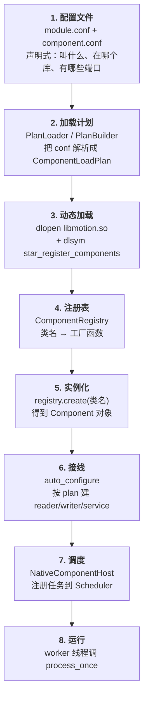
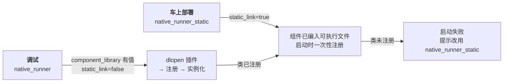
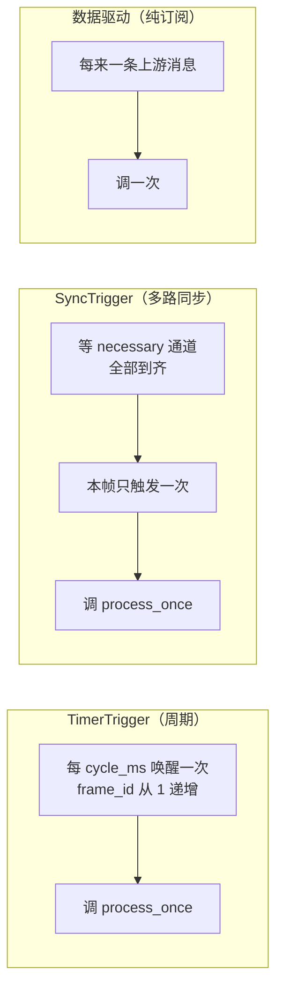

# 03 · 运行时装配：一个组件是怎么跑起来的

这一篇解释"我写了一个组件，系统怎么把它变成正在跑的代码"。理解这条链路，才能理解为什么 `component.conf` 里要写那些字段。

## 1. 装配总览

逐步说明：

| 步骤 | 谁做 | 输入 | 输出 | 出错会怎样 |
|---|---|---|---|---|
| 1 读配置 | `PlanLoader` | `*.conf` 文本 | 语法树 | 解析失败 → 启动报错 |
| 2 建计划 | `PlanBuilder` | 语法树 | `ComponentLoadPlan`（typed） | 缺必填字段 → 报错（schema 校验） |
| 3 加载库 | `ComponentDlHelper` | `component_library` 字段 | `dlopen` 句柄 | 找不到 `.so` → `doctor` 报错 |
| 4 注册 | 插件的 `register.cc` | registry 指针 | 类名→工厂映射 | 符号缺失 → 启动失败 |
| 5 实例化 | `ComponentRegistry` | 类名字符串 | `unique_ptr<Component>` | 类名写错 → 启动失败 |
| 6 接线 | `Component::auto_configure` | plan 的 inputs/outputs/services | 真实 reader/writer | 端口类型冲突 → 启动失败 |
| 7 调度 | `NativeComponentHost` | plan 的 trigger | Scheduler 任务 | 触发器类型未知 → 不调度（静默） |
| 8 运行 | `NativeScheduler` worker | 任务回调 | `process_once()` 被调 | 抛异常 → 记 failed 计数 |

## 2. 关键角色

```mermaid
flowchart LR
    subgraph HOST["NativeComponentHost（宿主）"]
        direction TB
        H1["持有 RuntimeContext"]
        H2["持有 ComponentRegistry"]
        H3["持有组件实例与 dlopen 句柄"]
        H4["驱动调度"]
    end
    subgraph CTX["RuntimeContext（能力集合）"]
        direction TB
        X1["message_bus 通道"]
        X2["service_bus 服务"]
        X3["scheduler 调度"]
        X4["parameter_store 参数"]
        X5["schema_registry 类型表"]
        X6["logger 日志"]
    end
    subgraph COMP["Component（业务对象）"]
        B1["只通过 context 拿能力"]
        B2["不直接碰 dlopen / 线程 / 共享内存"]
    end
    HOST --> CTX
    HOST --> COMP
    COMP -->|"context->message_bus()"| CTX
    style COMP fill:#1a3a2a,stroke:#34d399,color:#c9d6e8
```

- **ComponentRegistry**：类名 → 工厂函数的表。插件加载时往里注册，实例化时查表。
- **RuntimeContext**：一个"能力包"，组件通过它拿到总线、调度器、参数表等 7 样东西。组件不知道这些东西怎么实现的。
- **NativeComponentHost**：把上面两者组装起来，负责"加载→实例化→接线→调度"。

## 2.5 多进程监督

`star run --multi-process` 由 supervisor 按 process_group fork/exec worker：

- **ready 握手**：worker 在 `host.start()` 成功后通过继承的 `STAR_READY_FD` 写一个
  字节；超时或提前退出判为启动失败（`--ready-timeout-ms`，默认 3000ms）。
- **重启策略**：`--restart=on-failure`（默认 never）、`--max-restarts`（默认 3）、
  `--restart-backoff-ms`（默认 500，指数退避、封顶 32 倍）。预算耗尽则整体失败。
- **录制现场**：重启尝试的录制文件带 `.attempt<N>` 后缀，不覆盖上一次现场。

## 3. 两种装配方式（同一份 conf / plan）

- **插件模式**：`component_library` 指向 `.so`，换实现不用重编宿主；默认调试路径。
- **静态模式**：`native_runner_static` 链接所有模块的静态注册库，启动时调用
  `star_register_static_components()`；`static_link=true` 表示不再 dlopen。
  省掉启动加载/符号解析时间，适合车上部署。
- 两种模式共用同一套 `component.conf` / `ComponentLoadPlan`；差异只在
  “组件从哪里来”。静态 runner 仍可对未静态编入的类回退 dlopen（`static_link=false`）。

当前 4 个模块两种产物都有：`.so` 用于调试，`native_runner_static` 用于部署。

## 4. 触发策略：什么时候调你的 process_once

| 组件 | 策略 | 含义 |
|---|---|---|
| `setting/config` | Timer 1000ms | 每秒发一次快照 |
| `setting/parameter` | Timer 1000ms | 每秒发一次快照 |
| `planning/motion` | Sync（两路快照） | 配置和参数都到了才跑，保证同一帧看到一致数据 |
| `control/pid` | 数据驱动 | 来一帧轨迹算一次控制 |

> **对算法工程师的意义**：你不需要自己写 while 循环、不需要自己起线程。写 `process_once()` 就行，触发由框架负责。

## 5. 为什么这一套这么"重"

一个自然的疑问：为什么不直接写个 `main()` 里 `while(true) { 读数据; 算; 写数据; }`？

因为真实系统需要这些能力，而每一条都很难在业务代码里各自实现：

| 需求 | 手写 main 循环的做法 | 框架提供的 |
|---|---|---|
| 换算法不重编 | 做不到 | dlopen 插件 |
| 同一份数据给多个消费者 | 手动管理指针生命周期 | 通道 + 引用计数 |
| 跨进程零拷贝 | 自己设计共享内存协议 | transport |
| 多模块不同频率 | 多个线程 + 手写同步 | 调度器 + 触发器 |
| 数据格式演进 | 手写版本判断 | schema + 兼容检查 |
| 出问题能查 | 打日志 | monitor + 统计 + 录制 |

代价是**模板代码**：一个最小组件也要写 conf + register.cc + component + processor + meson.build 五处。这是当前易用性的主要痛点，改进方案见 [组件开发指南](../component_guide.md) 第 6 节。
