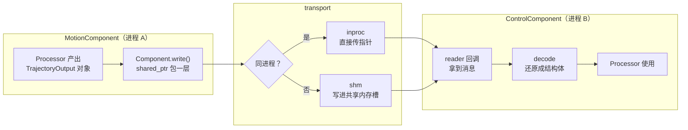
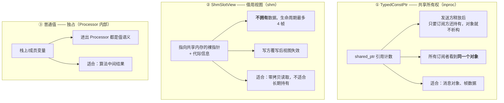
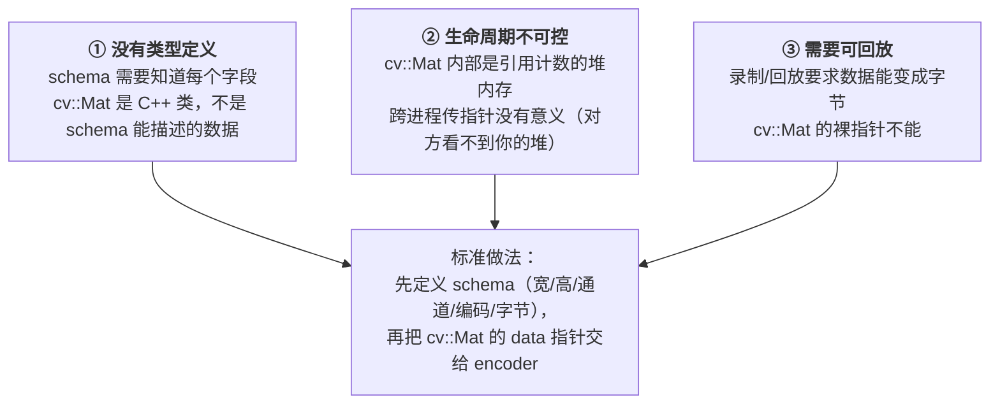
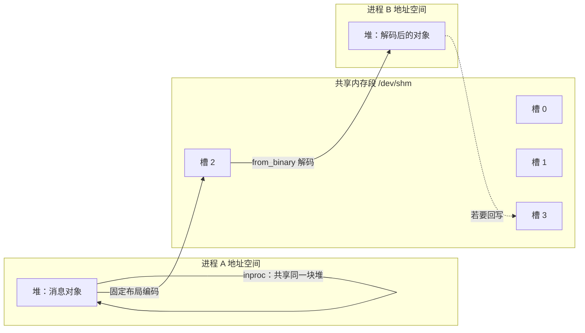

# 04 · 数据流与内存模型

这一篇回答算法工程师最常问的两个问题：**"我的大数组会被复制几次？"** 和 **"为什么我不能直接把 `cv::Mat` 传出去？"**

## 1. 一条消息的完整旅程

以 `planning/motion` 产出轨迹、`control/pid` 消费为例：

## 2. 每一步有没有拷贝（重要）

```mermaid
flowchart TB
    subgraph INPROC["inproc 路径（同进程）"]
        I1["① Processor 产出对象<br/>（1 次构造）"]
        I2["② write() 里 make_shared<br/><b>拷贝 1 次</b>（结构体浅拷贝）"]
        I3["③ 投递：只传 shared_ptr<br/><b>0 拷贝</b>"]
        I4["④ 读方类型转换<br/><b>0 拷贝</b>，拿到同一个对象"]
        I1 --> I2 --> I3 --> I4
    end

    subgraph SHM_FAST["shm 路径 · fixed-layout（推荐）"]
        S1["① 产出对象"]
        S2["② make_shared<br/><b>拷贝 1 次</b>"]
        S3["③ encode_into 直接写进共享内存槽<br/><b>0 中间缓冲</b>（这就是真零拷贝）"]
        S4["④ 读方 from_binary<br/><b>拷贝 1 次</b>（解码成对象）"]
        S1 --> S2 --> S3 --> S4
    end

    subgraph SHM_SLOW["shm 路径 · 变长二进制"]
        V1["① 产出对象"]
        V2["② make_shared<br/><b>拷贝 1 次</b>"]
        V3["③ encode_binary → 临时 vector<br/><b>拷贝 1 次</b>"]
        V4["④ memcpy 进共享内存槽<br/><b>拷贝 1 次</b>"]
        V5["⑤ 读方 from_binary<br/><b>拷贝 1 次</b>"]
        V1 --> V2 --> V3 --> V4 --> V5
    end
```

**诚实的结论**：

| 场景 | 端到端拷贝次数 | 说明 |
|---|---|---|
| 同进程（inproc） | **1** | 只有 `make_shared` 那一次结构体拷贝，之后全是指针 |
| 跨进程 + fixed-layout | **2** | 结构体 + 读方解码；中间没有临时缓冲 |
| 跨进程 + 变长二进制 | **4** | 结构体 + 序列化临时 vector + 写槽 + 读方解码 |

"零拷贝"这个词在这套系统里指的是**传输层不额外复制**（inproc 不序列化、shm 不经过内核 socket 缓冲），不是"端到端零拷贝"。`make_shared` 那次拷贝是为了保证消息在投递后仍然有效（发送方改了自己的对象不影响已发出的消息）。

## 3. 三种内存所有权模型

**对算法工程师的实际含义**：

- 你在 Processor 里算出来的东西，可以是任意类型（`std::vector`、`Eigen::Matrix`、你自己的类）。
- Component 负责把它变成"消息"（带 schema 类型、可编解码）。
- **不要**在 Component 里长期保存 `ShmSlotView`（它是借来的，4 帧后就指向别人的数据了）。
- **不要**假设收到的是"最新鲜"的数据：SHM 环只有 4 槽，落后超过 4 帧就会丢（会计入 `dropped`）。

## 4. 为什么不能直接传 `cv::Mat`

三个原因，按重要性排序：

正确做法是三步：

1. 在 `.schema` 里定义图像消息：`width / height / channels / encoding / bytes`
2. Component 里把 `cv::Mat::data` 交给编码器（`encode_into` 直接写进共享内存槽，不额外拷贝）
3. 订阅方拿到 `bytes` 后，用零拷贝方式包一个 `cv::Mat`（`cv::Mat(h, w, type, ptr, stride)`，注意要持有底层 buffer 的引用）

## 5. 容量边界（会直接影响算法设计）

| 项 | 当前值 | 算法侧含义 |
|---|---|---|
| 单帧上限 | **1 MiB** | 原始 1080p（6.2MB）、YUV420（3.1MB）、128 线激光雷达（约 2.6MB）**都超限** |
| 环形深度 | **4 帧** | 30fps 下只有 133ms 缓冲；订阅端处理慢就会丢帧 |
| 通道数成本 | 每通道 4 MiB | 40 个通道 = 160 MiB 共享内存 |
| 超限后果 | `ENCODE_FAILED` → 通道**永久降级**为进程内 | 需要应用层切块（当前 transport 不提供分片） |

> 这是当前最硬的工程约束，已列入 [修复方案](../remediation_plan.md) P0-4。

## 6. 一张图总结"数据在哪"

- 进程 A 的堆和进程 B 的堆**互不可见**——这是操作系统保证，不是框架限制。
- 共享内存是两边都能映射的一块物理内存，指针数值相同只是巧合（各进程映射地址可能不同），所以**不能把指针本身传过去，只能传偏移量**。框架已经封装好这件事。
