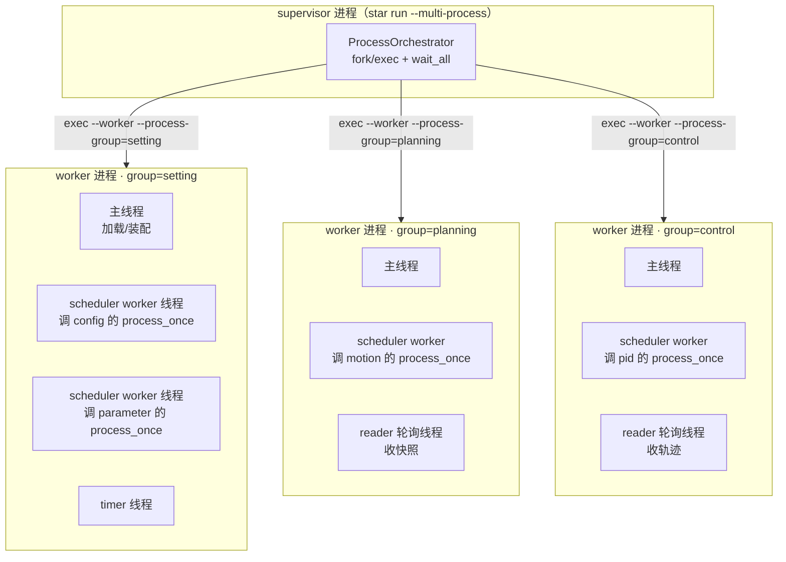
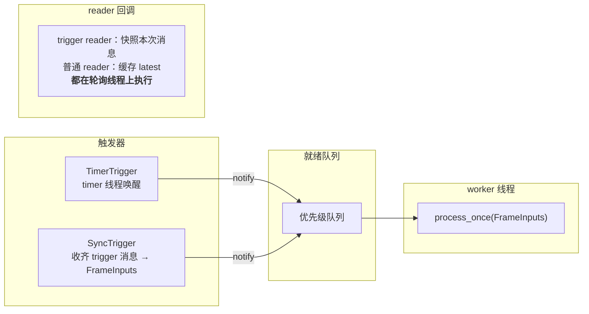
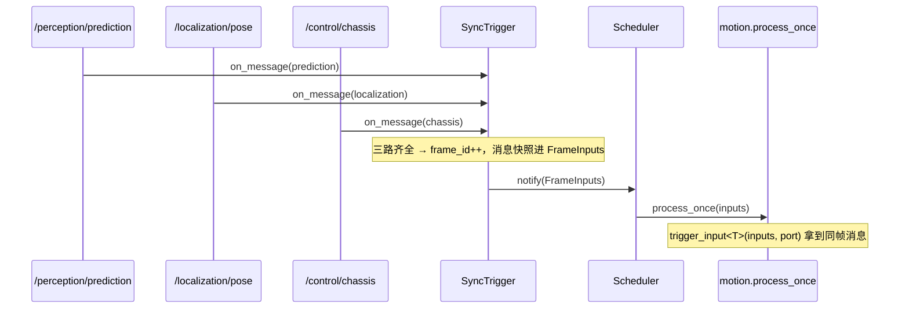
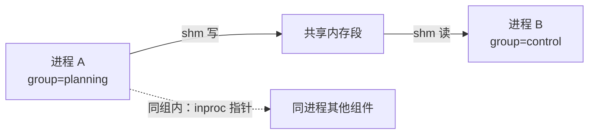

# 05 · 并发模型

这一篇讲清楚 **"我的代码在哪个线程上跑"**。对算法工程师来说，这决定了你能不能在 `process_once` 里做重活、能不能用非线程安全的数据结构。

## 1. 进程与线程总览

**每进程内的线程构成**：

| 线程 | 数量 | 干什么 |
|---|---|---|
| 主线程 | 1 | 读 conf、dlopen、装配、启动 |
| scheduler worker | `executor_threads`（1–4） | 从就绪队列取任务，调 `process_once()` |
| scheduler timer | 1 | 周期触发 `notify()` |
| 通道轮询线程 | **每个 shm 通道 1 个**（该通道的所有订阅者共享） | 从 shm 环读新帧，按各订阅者的 QoS 分发 |
| 统计/健康发布线程 | 各 1 个（健康线程仅在配置了 `health` 时启动） | 周期采样通道统计/健康状态，发布到 `/starletto/stats` / `/starletto/health` |
| ShmChannel 等待 | 0（复用通道轮询线程） | futex 等待 |

> 线程数 = 有 shm 订阅者的通道数，而不是订阅者数。8 个相机 × 3 个消费者是
> 8 个轮询线程（此前是 24 个）。读取只发生一次，分发时每个订阅者各自维护
> QoS 历史；订阅者析构会停掉该通道轮询线程并等回调结束，若还有其它订阅者再重启。

> 订阅者注销（Reader 析构）会等待自己正在执行的回调结束再返回；组件卸载后
> 不会再有回调踩到已销毁的捕获状态。回调内部不要再销毁同一个 Reader（会自等）。

## 2. 你的代码在哪个线程上被调

| 你写的代码 | 运行线程 | 可以做什么 | 不要做什么 |
|---|---|---|---|
| `init()` | 主线程（装配期） | 读一次性配置 | 开长循环、阻塞 |
| `process_once(const FrameInputs&)` | scheduler worker | 用本次 trigger 消息算算法、publish | 睡长觉、等锁 |
| trigger reader 回调 | **该通道专属轮询线程** | 快照 trigger 消息、做 FrameInputs | 做重计算、调阻塞 RPC |
| 普通 reader 回调 | **该通道专属轮询线程** | 只缓存最新 view | 做重计算、调阻塞 RPC |
| service handler | **该服务专属轮询线程** | 快速返回响应 | 长时间阻塞 |

**这条最重要**：reader 缓存回调是在轮询线程上**同步**执行的。回调里做 10ms 的计算，这个端口的读取就停顿 10ms，SHM 环可能在此期间被写满（4 帧）而丢数据。重活必须搬到 `process_once` 里，或者自己投递到队列。

## 3. 帧一致性与同步触发

`planning.motion` 由三路 trigger 输入驱动：`/perception/prediction`、
`/localization/pose`、`/control/chassis`。SyncTrigger 收齐三路后，把这**三条消息**
放进 `FrameInputs`，随 `process_once(inputs)` 一起交给组件：

若组件还有非 trigger 输入（例如未来接入的参数/配置快照），它们由普通 reader 缓存，
在 `process_once` 里用 `read_latest<T>()` 读取，不参与触发条件。

## 4. 锁与并发注意事项

| 位置 | 机制 | 你的代码要不要操心 |
|---|---|---|
| `NativeMessageBus` 的 channel 表 | `std::mutex` | 不用，`write()/read_latest()` 内部加锁 |
| `Component::latest_messages_`（仅非 trigger） | `std::mutex` | 不用，`read_latest()` 内部加锁 |
| `ChannelStats` 累计器 | 由总线锁保护 | 不用 |
| `SyncTrigger` | 内部锁，**回调在锁外执行** | 不用 |
| **你的 Processor 成员变量** | **没有任何保护** | **要操心**：同一个组件不会被两个线程同时调 `process_once`（scheduler 串行），但如果你的回调里也访问同一成员，就需要自己加锁 |

**最实用的三条规则**：

1. `process_once` 内部不需要锁（同一组件的任务由调度器串行执行）。
2. reader 回调与 `process_once` **可能在不同线程**，共享数据要加锁或只用原子标志。
3. Processor 保持**无状态或纯值成员**，是最省心的写法。

## 5. 多进程下的额外约束

- **跨进程只能传可序列化的数据**（见 [04](04-dataflow-and-memory.md)）。
- **同组内走指针**，跨组走共享内存——由 `ShmRoutedMessageBus` 自动判断，业务代码无感。
- 进程崩溃的后果：写共享内存的那个进程如果崩溃在写锁持有时，**该通道会永久卡死**（已知缺陷，见修复方案 P0-2）。
