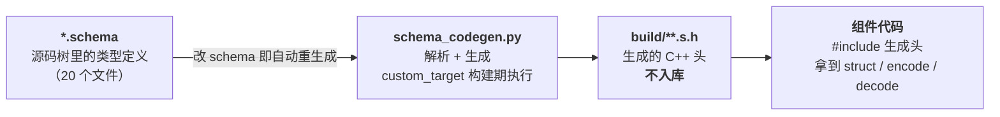
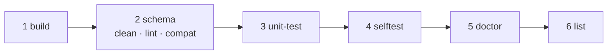

# 06 · 构建与质量门禁

## 1. `.schema` 如何变成可用的 C++ 类型



关键设计：**生成物不入库**。改了 `.schema` 之后 `ninja` 会自动重新生成，不存在"源码和生成物不一致"的问题。

生成的头里包含：

| 内容 | 用途 |
|---|---|
| `struct Xxx { ... }` | 你在 Processor 里直接用的 C++ 结构体 |
| `encode_binary() / from_binary()` | 变长二进制编解码 |
| `encode_fixed_layout_into() / XxxView` | 定长布局，供 shm 零拷贝 |
| `schema_type_id() / schema_descriptor()` | 运行时类型注册与校验 |

## 2. 提交要过的 10 项门禁



| # | 门禁 | 检查什么 | 失败意味着 |
|---|---|---|---|
| 1 | build | 编译 + 5 类告警提为错误 | 代码有编译错误或危险告警 |
| 2a | schema-clean | 生成物没回到源码树 | 有人把 `.s.h` 提交了 |
| 2b | schema-lint | 字段 id 重复/非法、名字重复 | IDL 有结构错误 |
| 2c | schema-compat | 与 git HEAD 比对兼容性 | 你改了字段 id / 类型 / 删了字段 |
| 3 | unit-test | 17 套 112 用例 | 有测试挂了 |
| 4 | selftest | transport 自检（并发、shm、降级） | 通信层坏了 |
| 5 | doctor ×3 | 每个模块的 conf 能正确解析、通道类型一致 | 配置写错 |
| 6 | list | 组件列表输出正常 | 装配链路坏了 |

一条命令跑完：`./star check`（当前 10/10 PASS）。

## 3. 与算法开发的关系

- 你改 `.schema` → 门禁 2c 会检查兼容性。**删字段、改类型、改 id 会被拦下**，因为会让已录制的数据、其他进程解析失败。
- 你只改 Processor → 只有门禁 1 和 3 相关，很快。
- 你加新组件 → 门禁 5（doctor）会检查 conf 是否与代码一致。

## 4. 目录速查

```
basement/          运行时底座（~11k 行）
├── core/          日志、异常、时钟、类型擦除指针
├── schema/        IDL、codegen、编解码、注册表
├── transport/     通道、服务、shm、录放
└── runtime/       组件、调度、触发器、进程编排、观测
libraries/         算法资产（3500 行，未接线）
modules/           业务组件（4 个）
apps/              宿主与工具
tests/             17 套 112 用例
docs/              本目录
tools/arch_site/   架构网站源码（TS）
```
