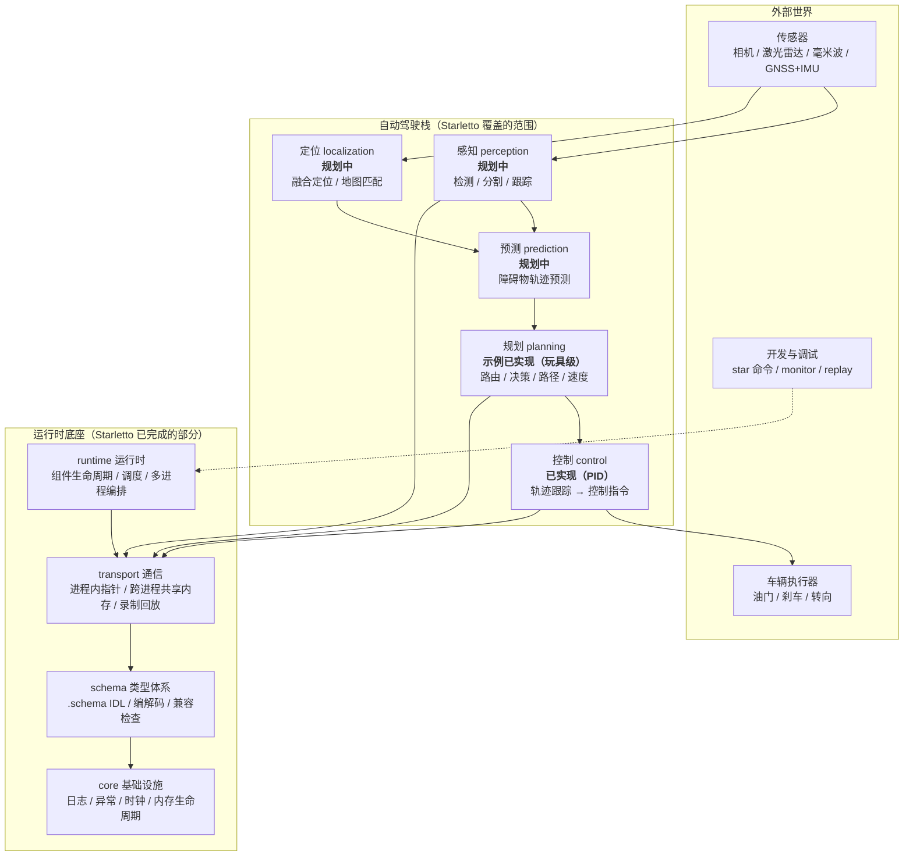

# Starletto 系统架构图集

> 读者：**算法工程师**。你熟悉 C++ 算法本身，但不一定熟悉进程、线程、共享内存、动态加载这些系统侧的概念。
> 这份文档集用图 + 白话解释，回答三个问题：**系统长什么样、我的算法坐在哪里、数据怎么从 A 流到 B**。

## 六张图与阅读顺序

| # | 文档 | 回答的问题 |
|---|------|-----------|
| 1 | [01 系统全景与当前实现](01-system-context.md) | 一个完整的自动驾驶系统有哪些模块？Starletto 实现了哪些、没实现哪些？我的算法应该写在哪一格？ |
| 2 | [02 分层与模块职责](02-layers-and-modules.md) | 每一层/每个模块具体做什么（输入→处理→输出）？依赖规则为什么这么定？ |
| 3 | [03 运行时装配](03-runtime-assembly.md) | 一个组件是怎么被"装"进进程并跑起来的？配置文件、插件、注册表各自扮演什么角色？ |
| 4 | [04 数据流与内存模型](04-dataflow-and-memory.md) | 一条消息从产生到消费经过哪里？"零拷贝"到底省掉了什么？我的大数组会不会被复制？ |
| 5 | [05 并发模型](05-concurrency-model.md) | 有几个进程、每进程几个线程？我的 `process_once` 和回调分别在哪个线程上跑？能做什么不能做什么？ |
| 6 | [06 构建与门禁](06-build-and-gates.md) | `.schema` 怎么变成 C++ 类型？提交前要过哪些自动检查？ |

配套文档：

- [修复方案](../remediation_plan.md) — 当前已知缺陷与修复计划
- [组件开发指南](../component_guide.md) — 以 planning 为例，写一个组件到底要写哪些文件

---

## 图 0 · 系统全景：一张图看懂"你在哪"

**怎么读这张图**：

- 上半部分（感知→定位→预测→规划→控制）是**业务流水线**。一个算法工程师的日常工作几乎都在这一层。
- 下半部分（runtime/transport/schema/core）是**底座**。它不关心"什么是障碍物"，只负责"把一段数据安全、快速、可调试地从 A 送到 B"。
- 中间那条箭头（业务 → transport）是**唯一的接口面**：业务只通过 `Component` 的 publish/subscribe 与外界交互，不直接碰共享内存、不直接开线程。

> 当前状态：底座已完成（112 个测试、10 项 CI 门禁），业务模块除 planning/control 的示例外均为规划中。详见 [01](01-system-context.md)。
