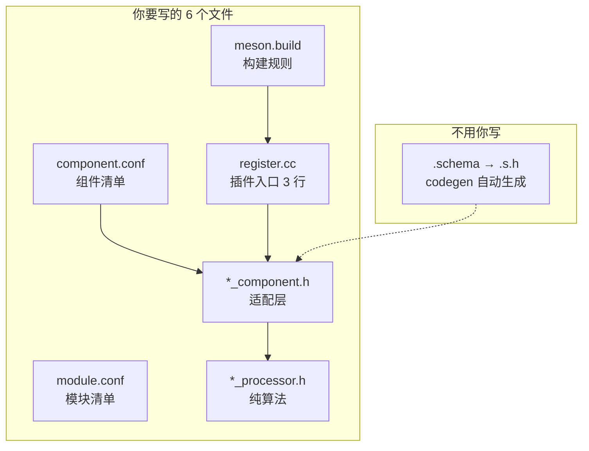
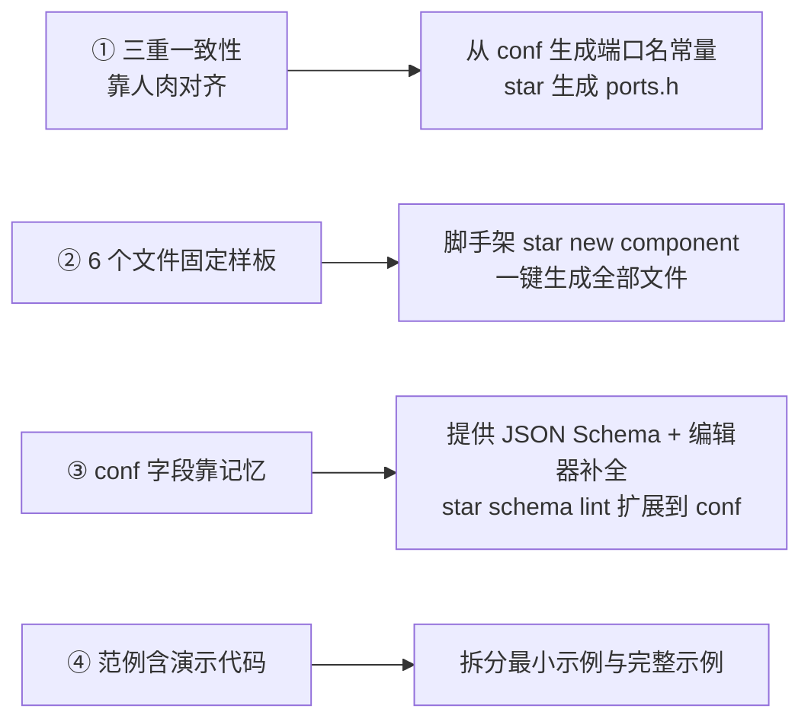

# 组件开发指南（易用性）

> 目标读者：**要新写一个业务模块的工程师**。
> 这篇文章回答一个问题：**"从零加一个组件，我到底要写哪些文件、每一行是干什么的、哪些可以照抄。"**
> 以 `planning/motion` 为真实样本，逐文件拆解。

---

## 0. 命名：路径与逻辑名

- 文件系统/CLI 目标用 `/`（相对路径）：`modules/planning/motion`、`star run planning/motion`；
- 组件逻辑 ID 用 `.`：`planning.motion`；
- **通道是数据存放地址**，用绝对路径：`/planning/trajectory`、`/perception/prediction`、
  `/localization/pose`、`/control/chassis`；
- schema 是类型名，用 `.`：`planning.trajectory`、`perception.prediction`；
- C++ 类型用 `::`：`star::planning::Motion`；
- 服务通道：`<service>/request` / `<service>/response`（如 `/setting/parameter/get/request`）。

不要把 schema 名当通道名；通道地址用 `/`，类型名用 `.`。

## 1. 总览：一个组件涉及 6 个文件



| 文件 | 必需 | 行数量级 | 改动频率 | 主要风险 |
|---|---|---|---|---|
| `module.conf` | ✅ | 15 | 一次性 | `components [...]` 漏登记 |
| `component.conf` | ✅ | 20–40 | 接线变化时 | 端口名/类型写错，doctor 报错 |
| `register.cc` | ✅ | 3 | 几乎不变 | 导出符号名写错 |
| `*_component.h` | ✅ | 30–100 | 端口变化时 | 字符串端口名与 conf 不一致 |
| `*_processor.h` | ✅ | 算法规模 | **每天** | 无 |
| `meson.build` | ✅ | 20 | 一次性 | 依赖链漏 `planning_dep` |
| `*.schema` | 有新消息时 | 10–30 | 数据结构变化时 | 改 id/类型会被兼容检查拦下 |

**结论：模板量约 90 行，其中约 60 行是固定样板，真正需要思考的是 conf 与 schema 的设计。**

---

## 1.5 快速开始：先让脚手架生成骨架

```bash
star new module my_module               # modules/my_module/{module.conf, meson.build}
star new component my_module/my_node    # 6 个文件 + 自动登记 module.conf / meson
star build
star run my_module
```

生成物已经保证三处一致：`component_library = libmy_node.so`、`component_class =
star::my_module::MyNode`、`register_native_components` 注册同一字符串；父
`module.conf` 的 `components` 列表与 `meson.build` 的 `subdir` 也会自动补上。

之后只需要：

1. 在 `my_node_processor.h` 写算法；
2. 在 `my_node_component.h` 用 `trigger_input<T>(inputs, "trigger_port")`（trigger 端口）/ `read_latest<T>("other_port")`（非 trigger）/ `write("port", msg)` 接线；
3. 在 `component.conf` 补 `readers`/`writers`（键名与代码字符串一致）。

脚手架不覆盖已有文件，也不允许非法名字；重复执行或模块不存在会直接报错。
下面第 2 节是每个文件的职责说明，需要手改时对照即可。

## 2. 逐文件模板

### 2.1 `module.conf` —— 模块清单

```conf
module {
    name = planning            # 模块名，必须与目录名一致
    version = 0.1.0
    default_backend = native
    install_group = core
}

layout {
    config_dir = config        # 相对路径，指向本模块的配置文件目录
    component_dir = .          # 组件 conf 的基准目录
}

components [motion/component.conf]   # ← 漏登记 = 组件不会被加载

dependency {
    modules [setting]          # 依赖哪个模块的数据
    libraries [element, method]
}
```

**唯一容易出错的点**：`components [...]` 是个数组，加组件必须在这里登记，否则 `star list` 看不到它。

### 2.2 `component.conf` —— 组件清单（最重要的文件）

```conf
global {
    process_group = planning       # 决定同进程/跨进程：同组走指针，跨组走共享内存
    scheduler_policy = multi_thread
    executor_threads = 4
}

component {
    name = motion                  # 端口日志与统计里的显示名
    type = planning
    component_library = libmotion.so   # ← 插件文件名，必须与 meson 产物一致
    component_class = star::planning::Motion   # ← 必须与 register 的类名一致
    priority = 10
}

trigger {                          # 什么时候调 process_once
    type = channel                 # timer | channel | sync_topic
    readers [prediction, localization, chassis]   # 三路到齐才跑
}

readers {                          # 订阅的通道；键名 = 代码里的端口名
    prediction {
        channel = /perception/prediction
        type = star::perception::prediction::Prediction
    }
    localization {
        channel = /localization/pose
        type = star::localization::pose::Pose
    }
    chassis {
        channel = /control/chassis
        type = star::control::chassis::Chassis
    }
}

writers {                          # 发布的通道
    trajectory {
        channel = /planning/trajectory
        msg_type = star::setting::planning::TrajectoryOutput
        record = true              # 是否写入 STARREC 录制
    }
}
```

Trigger 规则（plan 会校验）：

- `type=timer`：只允许 `cycle_ms`，不能声明 `trigger.readers`；
- `type=channel`：`readers` 至少一路；多路时按 SyncTrigger 等全部到齐；
- `type=sync_topic`：显式多路同步，等价于多 reader 的 channel；
- trigger 端口的消息随 `process_once(inputs)` 传入；非 trigger 端口才用 `read_latest`。

**三个必须一致的地方**（当前靠人肉保证，见第 4 节）：

1. `component_library` = meson 里 `shared_library('motion', ...)` 的产物名
2. `component_class` = `register_native_components` 里注册的字符串
3. `readers/writers` 的**键名** = 代码里 `trigger_input(..., "...")` / `read_latest("...")` / `write("...", ...)` 的字符串

#### 跨版本通信：`decode_policy`（可选）

生产者和消费者编译在不同版本的同一个 schema 时，接收端按通道决定怎么处理差异。
默认值已经是「尽量兼容」，只在需要更严格或更宽松时显式写：

```conf
readers {
    parameter_snapshot {
        channel = /setting/parameter/snapshot
        type = star::generated::setting::parameter::snapshot::ParameterSnapshot
        decode_policy {
            unknown = keep         # error | keep（默认）| drop
            missing = default      # error | default（默认）
            type_mismatch = error  # error（默认）| best_effort
        }
    }
}
```

| 配置 | 含义 | 什么时候用 |
|---|---|---|
| `unknown=keep` | 保留生产者新增字段的原始字节，随消息继续传递 | 默认；滚动升级时旧进程不丢数据 |
| `unknown=error` | 出现不认识的字段立即报错 | 控制通道：宁可停也不要跑错 |
| `missing=default` | 缺字段用 schema 默认值补；没有默认值且非 optional 时仍报错 | 默认；旧生产者 → 新消费者 |
| `missing=error` | 缺字段即报错 | 严格契约：要求对方必须发全 |
| `type_mismatch=best_effort` | 只做安全转换（数值↔数值、数值→字符串），否则报错 | 历史字段类型改过且需平滑过渡 |

注意两点：

- **字段删除/改名是编译期错误**，没有运行时策略——源码引用了不存在的字段，编译直接失败，这是正确行为。
- **固定布局帧（`*View` 零拷贝读取）不支持跨版本**：它按位置取值，没有字段 id。帧头带 schema 身份，版本不一致时直接拒绝，不会读出错位数据。

#### 健康检查：`health` 块（可选）

```conf
health {
    channel = /planning/trajectory   # 要监控的通道（省略则只查资源）
    min_hz = 10                     # 低于该频率告警
    window_ms = 2000                # 评估周期
    max_cpu_percent = 90
    max_rss_mb = 512
    max_fd_count = 256
}
```

配置后，worker 进程会启动一个评估线程（未配置则不启动）：按周期检查通道频率与
进程资源（CPU/RSS/fd），严重度变化时写日志，并把报告发布到普通通道
`/starletto/health`；`star monitor` 会直接列出未健康的组件与原因。

资源项默认 90% / 512MB / 256，只配 `channel` 也会按默认阈值检查资源；三项都不配
则只做通道频率检查。

#### 提供/调用服务（`commands` 块）

服务就是两条普通通道，没有单独的「服务总线」：

```conf
commands {                          # 本组件提供的服务（server 侧）
    get {
        channel = /setting/parameter/get
        type = star::setting::service::parameter::get_request::ParameterGetRequest
        ack_type = star::setting::service::parameter::get_response::ParameterGetResponse
    }
}
```

组件里覆写 `handle_service_request(name, request)` 按 `name`（= commands 的键名）分发；
客户端直接基于同一个 `MessageBus` 调：

```cpp
auto client = star::transport::RpcClient{context()->message_bus(), "/setting/parameter/get"};
auto response = client.call_serialized(make_typed_request(request));
```

因为走的是普通通道，服务流量自动进路由计划、录制、通道统计与类型校验；
`<service>/request`、`<service>/response` 在 `star monitor` 里和普通 topic 一样可见。


### 2.2.1 日志与排查

日志默认文本格式，带 `pid=` 与 `tid=`，多进程下能直接区分来源进程/线程：

```
2026-11-12T01:07:49.310525 INFO  [pid=29825 tid=0x20b2f0f40] app.cc:67 run loaded component: parameter
```

需要机器可读时用 JSON（单行、消息已转义）：

```bash
STAR_LOG_FORMAT=json star run modules/setting/module.conf
```

| 环境变量 | 作用 | 默认 |
|---|---|---|
| `STAR_LOG_LEVEL` | 全局级别 `DEBUG/INFO/WARN/ERROR` | `INFO` |
| `STAR_LOG_FORMAT` | `text` 或 `json` | `text` |
| `STAR_LOG_ASYNC` | `1` 异步写、`0` 同步写 | 文件日志 `1`，stdout `0` |
| `STAR_LOG_FILE` | 写滚动文件而不是 stdout | 无 |

模块级级别写在 `module.conf`，只影响该模块（调度线程进入任务时切换，查表不进热路径）：

```conf
logging {
    level = DEBUG
}
```

### 2.3 `register.cc` —— 插件入口（永远照抄）

```cpp
#include "basement/core/build_info.h"
#include "basement/runtime/component/component_registry.h"
#include "modules/planning/motion/motion_component.h"

// 静态装配入口：native_runner_static 直接调用，不 dlopen
extern "C" void star_static_register_planning_motion(star::runtime::ComponentRegistry* registry) {
    if (registry != nullptr) {
        star::planning::register_native_components(*registry);
    }
}

#ifndef STAR_STATIC_COMPONENTS_ONLY
extern "C" void star_register_components(star::runtime::ComponentRegistry* registry) {
    star_static_register_planning_motion(registry);
}
STAR_EXPORT_TOOLCHAIN_FINGERPRINT()
#endif
```

- 静态符号名固定为 `star_static_register_<module>_<component>`；`star new component`
  会自动生成并接入静态库列表。
- 动态插件仍导出 `star_register_components` + 指纹；两者共用同一实现。

如果模块自带 schema，插件入口还要负责注册它们（app 不再知道任何模块）：

```cpp
#include "basement/core/build_info.h"
#include "modules/<module>/schema/schema_bootstrap.h"

extern "C" void star_register_components(star::runtime::ComponentRegistry* registry) {
    star::<module>::schema::register_<module>_schemas(*registry->schema_registry());
    star::<module>::register_native_components(*registry);
}
STAR_EXPORT_TOOLCHAIN_FINGERPRINT()
```

注册是幂等的；同一模块的多个插件各自注册也没问题。`star check` 的 `app-boundary`
会阻止 `apps/` 重新 include 模块内部。

### 2.4 `*_component.h` —— 适配层

最小形态（去掉日志演示后）：

```cpp
#pragma once
#include "basement/runtime/component/component.h"

namespace star::planning {

class MotionComponent : public star::runtime::Component {
  public:
    auto process_once(const star::runtime::FrameInputs& inputs) -> bool override {
        // 1a. trigger 输入：本次触发的消息随 process_once 传入
        const auto pose = trigger_input<Pose>(inputs, "localization");

        // 1b. 如有非 trigger 输入，才用 read_latest：
        //     const auto snap = read_latest<ParamSnapshot>("parameter_snapshot");

        // 2. 组装成纯算法输入
        auto input = MotionInput{};
        if (pose) { input.xxx = pose->xxx; }

        // 3. 调算法
        const auto output = processor_.process(input);

        // 4. 发布（端口名必须与 conf 的 writers 键名一致）
        (void)write("trajectory", output);
        return true;
    }

  private:
    MotionProcessor processor_;
};
}  // namespace star::planning
```

可选钩子：

| 钩子 | 何时用 |
|---|---|
| `init()` | 一次性初始化（读配置、建索引） |
| `shutdown()` | 释放外部资源 |
| `read_latest<T>("port")` | 读取**非 trigger** 端口的最新值（参数/配置快照等） |
| `trigger_input<T>(inputs, "port")` | 读取本次触发 `process_once` 的消息（trigger 端口） |
| `write("port", msg)` | 发布到 `component.conf` 声明的 writer 端口 |

#### 零拷贝读取（`peek_view`，当前不推荐）

`peek_view<XxxView>("port")` 可以直接在共享内存上构造只读视图，不拷贝、不解码。
但它要求生产者写入**固定布局帧**；当前 shm 默认写二进制 TLV（为跨版本演进），
所以普通 `write()` 产生的帧不能被 View 读取。等 per-channel `encoding=fixed`
配置落地后再在业务中使用；现在请用 `read_latest<T>`。

### 2.5 `*_processor.h` —— 纯算法（算法工程师的主战场）

```cpp
#pragma once
#include "modules/setting/schema/planning/trajectory.s.h"

namespace star::planning {

struct MotionInput {
    double vehicle_x{0.0};
    double vehicle_y{0.0};
};

class MotionProcessor {
  public:
    auto process(const MotionInput& input) -> star::setting::planning::TrajectoryOutput {
        auto output = star::setting::planning::TrajectoryOutput{};
        // ... 纯算法，不碰总线/线程/共享内存 ...
        return output;
    }

  private:
    int64_t frame_id_{0};
};
```

**约束**：不 include `basement/transport/*`、`basement/runtime/*`。这样能离线单测、离线回放。

### 2.6 `meson.build` —— 构建规则（照抄改名字）

```meson
motion_sources = files('motion_component.h', 'motion_processor.h')

motion_dep = declare_dependency(
    sources: motion_sources,
    dependencies: [planning_dep],       # ← 依赖本模块的公共头
)

install_data('component.conf', install_dir: 'modules/planning/motion')

shared_library(
    'motion',                            # ← 产 libmotion.so，与 conf 的 component_library 对应
    files('register.cc'),
    dependencies: [motion_dep],
    name_suffix: 'so',
    install: true,
    install_dir: 'modules/planning/motion',
)

# 静态部署：同一份 register.cc 编成 .a，供 native_runner_static 链接
motion_static_lib = static_library(
    'motion_static',
    files('register.cc'),
    dependencies: [motion_dep],
    cpp_args: ['-DSTAR_STATIC_COMPONENTS_ONLY'],
)
static_component_symbols += ['planning_motion']
static_component_static_libs += [motion_static_lib]
```

### 2.7 静态装配（车上部署）

`star build` 同时产出 `native_runner`（调试，dlopen）与
`native_runner_static`（部署，组件已编入）。组件 conf 写 `static_link = true`
时，宿主不会 dlopen；类未静态注册会启动失败并提示使用静态 runner。

```bash
./star run --static planning
```

静态 runner 的模块列表来自 `modules/meson.build` 的
`static_component_symbols` / `static_component_static_libs`；新增组件请用
`star new component`，它会自动接线。

---

## 3. 真实示例拆解：`motion` 里哪些是必需的

`motion_component.h` 约 57 行，真正必需的是端口读取 + 算法调用 + 写入：

| 代码块 | 说明 |
|---|---|
| 8 个 include | basement + processor + 3 个上游 schema + trajectory |
| `process_once(const FrameInputs&)` | 核心：`trigger_input` 取三路消息 → 算 → `write` |
| frame/trajectory 日志 | 可选的运行观测，不属于组件装配必需项 |
| `register_native_components()` | 注册唯一类名 `star::planning::Motion` |
| 成员 `processor_` | 纯算法对象 |

组件里不再出现“参数快照打印”这类只用于演示的代码；需要非 trigger 输入时用
`read_latest<T>()`，并在 `component.conf` 声明对应 reader。

---|---|---|---|
| 9 个 include | 9 | ✅ | 4 个 basement + 1 processor + 4 个 schema |
| `process_once(const FrameInputs&)` | 20 | ✅ | 核心：取 trigger 消息 → 算 → 发 |
| `maybe_log_first_parameter_snapshot()` | 30 | ❌ **演示用** | 只是打印一次参数，可删 |
| `maybe_log_first_config_snapshot()` | 25 | ❌ **演示用** | 同上 |
| `register_native_components()` | 4 | ✅ | 注册类名 |
| 成员变量 | 3 | 部分 | 两个 `logged_*` 是演示用的 |

> **这是当前易用性的一个真实问题**：范例组件里混了 55 行演示日志，让"最少要写什么"变得不清楚。建议把演示日志剥到单独示例，主示例只保留最小骨架。

---

## 4. 三重一致性：最容易踩的坑

同一个"端口"信息写在**三个地方**，且没有编译期校验：

```mermaid
flowchart LR
    C["<b>component.conf</b><br/>writers.trajectory<br/>msg_type=TrajectoryOutput"]
    K["<b>组件代码</b><br/>write(\"trajectory\", output)"]
    S["<b>schema</b><br/>star::setting::planning::TrajectoryOutput"]
    C -.->|"运行时按字符串匹配"| K
    K -->|"C++ 类型"| S
    C -.->|"运行时注册表校验"| S
    style C fill:#3a2a1a,stroke:#fbbf24
    style K fill:#3a2a1a,stroke:#fbbf24
```

| 不一致 | 后果 | 什么时候发现 |
|---|---|---|
| conf 端口名 ≠ 代码字符串 | 运行时 `write` 抛"writer not declared" | 启动时 |
| conf `msg_type` ≠ 代码类型 | 立即抛 schema 不匹配 | 启动时 |
| conf `component_class` ≠ 注册名 | `registry.create` 返回空 | 启动时 |
| conf `component_library` ≠ .so 名 | dlopen 失败 | `star doctor --deep` |
| `module.conf` 漏登记 | 组件根本不加载 | `star list` 看不到（**最容易漏**） |

好消息是这些错误大多在**启动时**就报，不会静默跑错数据。坏消息是它们只能运行时发现。

---

## 5. 常见错误与诊断

| 现象 | 原因 | 排查 |
|---|---|---|
| `star list` 里没有我的组件 | `module.conf` 的 `components []` 漏登记 | 看 module.conf |
| 启动报 `SchemaValidator unknown field: ComponentConf.xxx` | conf 拼错/写了不存在的块（如 `readres`） | 对照组件 schema 的字段名 |
| `doctor` 报 `empty component_library but static_link=false` | conf 既没库也没标静态 | 补 `component_library` |
| `dlopen failed: lib=X` | `.so` 名字不匹配或未安装 | `star doctor --deep` |
| `create component failed: 类名` | `component_class` 与注册名不一致 | 对照 `register_native_components` |
| `write failed: writer not declared` | 端口名拼写不一致 | 对照 conf 的 `writers` 键名 |
| 组件跑了但收不到数据 | 上游 channel 名不一致，或 `trigger.readers` 写了不存在的端口 | 对照 `star graph --components` |
| 数据是旧的/丢帧 | SHM 环只有 4 槽（133ms），订阅端处理慢 | 看 `star monitor` 的 dropped |

---

## 6. 易用性改进路线

当前痛点按影响排序，以及建议的改法：



| 改进 | 具体做法 | 收益 |
|---|---|---|
| **P1 脚手架** ✅ | `star new module/component` 生成 6 个文件，自动登记 module.conf / meson；`tools/tests/scaffold_selftest.py` 进 CI 锁定接线正确性 | 从"查文档拼 6 个文件"变成"改 1 个文件"（2026-11-14 完成） |
| **P1 端口常量** | codegen 为每个组件生成 `ports.h`：`constexpr auto kWriterTrajectory = "trajectory";` | 端口名从字符串变成编译期常量 |
| **P2 conf 校验** | 用 `component.schema` 的 descriptor 驱动 conf lint（现在只在加载时校验） | 提交前发现 conf 错误 |
| **P2 最小示例** | 新增 `examples/minimal_component/`，约 60 行，去掉一切演示代码 | 新人 10 分钟能跑通 |
| **P3 端口自动推导** | 由 schema 类型反推端口名，conf 只写 channel | 再少一层重复 |

**判断标准**：一个熟练工程师加一个"读一路数据、发一路数据"的组件，应该 **< 30 分钟、只改 2 个文件**。脚手架落地后，文件生成本身已经不需要时间，剩余成本集中在端口接线与算法本身。

---

## 7. 最小清单（Checklist）

新加一个组件时按此顺序：

```
[ ] 0. 跑脚手架（或手写 6 个文件）         → star new component <mod>/<name>
[ ] 1. 定义 schema（如需要新消息）        → modules/<mod>/schema/xxx.schema
[ ] 2. 写 processor（纯算法）             → modules/<mod>/<name>/<name>_processor.h
[ ] 3. 写 component（适配层）             → modules/<mod>/<name>/<name>_component.h
[ ] 4. 写 register.cc（照抄改 include）    → modules/<mod>/<name>/register.cc
[ ] 5. 写 component.conf                  → 端口名与代码字符串逐一对齐
[ ] 6. 写 meson.build（照抄改名）          → 库名与 conf 的 component_library 对齐
[ ] 7. 在 module.conf 登记                → components [<name>/component.conf]
[ ] 8. ./star build                       → 编译通过
[ ] 9. ./star doctor --deep               → conf 与插件一致性通过
[ ] 10. ./star list                       → 能看到新组件
[ ] 11. ./star run --frames=10 <module>   → 能跑起来
[ ] 12. ./star check                      → 全量门禁通过
```

前 7 步是写代码，后 5 步是验证。如果第 9–11 步报错，直接查第 5 节表格。
