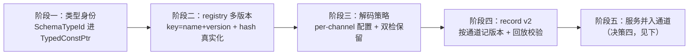
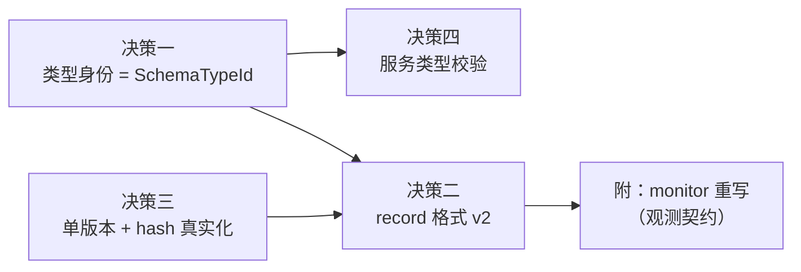

# 底层契约决策记录（已确认）

> 日期：2026-11-11
> 目的：P2 的六项里有四项是**契约级**改动（类型身份、schema 演进、录制格式、服务类型），会同时波及
> `TypedConstPtr`、transport 类型校验、record 格式、registry、codegen 五处。
> 本文件把需要先定的契约问题逐个展开：现状与证据、选项、建议、理由、收益、不决策的代价、影响面。
> 状态：**已由 owner 确认（2026-11-12）**。决策二与决策三合并为一项能力（多版本 Schema 演进）；
> 决策四结论为「通道可以满足全部需求，服务抽象撤销」。
> 确认后应同步进 `spec/` 与 `design_change.md`。

---

## 决策一：组件间消息的「类型身份」用什么

### 这是什么

两个组件通过通道传一条消息时，接收方必须回答一个问题：**"这条字节/指针，真的是我以为的那个类型吗？"**

当前实现（`basement/core/common_types.h:10-48`）：`TypedConstPtr` 内部存三样东西——

```cpp
std::shared_ptr<const void> ptr;   // 数据
const std::type_info* type;        // C++ RTTI 类型信息
const char* type_name;             // mangled 名字字符串
```

`as<T>()` 先比较 `typeid`，不等再 `strcmp` mangled name（`:34-47`）。

### 为什么是问题（四条，逐条有证据）

1. **跨 DSO 没有标准保证**。C++ 标准只要求"同一类型的 `typeid` 相等"，但主流实现按 `type_info` 对象地址比较；`-fvisibility=hidden` 时不同 DSO 会拿到不同地址。当前靠 `strcmp(name())` 兜底（`common_types.h:41`），把正确性押在 Itanium mangled name 的跨 DSO 一致性上。
2. **换编译器/标准库即失效**。clang 的 mangled name 与 gcc 不同（如 `std::__1::` 前缀），两套插件混用会**错误强转**而不是安全返回空。
3. **ODR 违规变成错误强转**。两个 DSO 各定义了一个同名但不同的类型（历史上有过：`astar.h`/`dijkstra.h`/`bellman_ford.h` 共用同一个 include guard），mangled name 相同 → `strcmp` 相等 → 错误强转 → 把 A 类型的字节当 B 类型读。
4. **payload 生命周期绑在生产者 DSO 上**。`shared_ptr` 的 control block 由创建方 DSO 实例化；`DlHandle` 析构会 `dlclose`（`component_dl_helper.h:35-43`），此后析构会跳进已卸载的代码。`type`/`type_name` 裸指针同样指向生产者 DSO 的静态存储。

### 选项

| 选项 | 做法 | 取舍 |
|---|---|---|
| A. 维持现状 | 依赖 mangled name + 人工纪律 | 零改动；插件生态与跨编译器场景 correctness 靠运气 |
| B. **SchemaTypeId 作为唯一身份** | `TypedConstPtr` 增加 `schema::SchemaTypeId{name, version, hash}` 字段；`as<T>()` 改为先比 TypeId；`typeid` 降级为 debug 断言 | 类型身份来自 schema（本就是系统的类型源）；跨 DSO 稳定（纯值比较）；跨语言可行 |
| C. 完全去 RTTI | 手写 tag + 工厂 | 与 B 等价但多一套机制，无额外收益 |

### 建议：B ✅ 已确认

### 理由

- **类型源唯一**。系统已经有 schema 作为"唯一类型源"的硬约束，消息类型身份理应从 schema 来，而不是从编译器 RTTI 来。现在等于有两套类型系统并行（schema 管字节、RTTI 管指针），它们不一致时没有报错点。
- **纯值比较跨 DSO 稳定**。`SchemaTypeId` 是三个标量字段，比较不依赖任何进程内地址。
- **是跨语言的前置条件**。将来任何 Python/Rust 组件不可能提供 C++ `type_info`。
- **改动是加法**：`as<T>()` 增加一次 TypeId 比较，现有按 `typeid` 的路径降级为 debug 断言，不破坏现有组件。

### 收益

- 插件生态成立：不同 DSO 编译的组件之间类型判断可靠
- ODR 类错误从"错误强转读脏数据"变成"类型不匹配、消息被拒并可诊断"
- 为跨语言组件（P2 之后）扫清第一个障碍

### 不决策的代价

每新增一个插件 DSO，类型误判风险增加一分；且这种错误的表现是"读到撕裂数据/字段错乱"，定位成本极高。

### 影响面

`common_types.h`（加字段）、`component.h`（类型不匹配时校验 TypeId）、生成代码（`.s.h` 的类型已带 `schema_type_id()`，可直接填入）。预估 1 天 + 回归。

---

## 决策二 + 三（合并）：多版本 Schema 演进 ✅ 已确认

> Owner 决定：**必须支持跨版本回放、甚至跨版本收发**，且对版本不一致的响应方式可配置。
> 这同时回答了原决策二（录制格式）与决策三（registry 多版本）——它们本来就是同一件事的两半：
> 录制要跨版本，registry 就必须存多版本；registry 存了多版本，收发才能跨版本。合并为一项能力。

### 这是什么

让生产者与消费者**各自使用不同版本的同一个 schema** 仍能正确通信与回放：

- 生产者编译并发布 v2（新增了字段），消费者仍编译在 v1
- 录制文件由 v2 进程产出，回放给 v1 进程
- 版本不一致时的行为**按通道配置**，而非全局一刀切

### 需要的机制（五块）

| # | 机制 | 说明 |
|---|---|---|
| 1 | **wire 携带版本** | 生产者在通道上声明其 schema 版本；消费者编译版本已知 → 双方都知道是否一致。录制文件头按通道记录版本 |
| 2 | **registry 多版本共存** | key 从 `name` 改为 `name+version`；同名 v1/v2 同时注册；重复注册同 key 校验内容一致（不再静默返回） |
| 3 | **解码策略（per-channel 配置）** | 见下表 |
| 4 | **hash 真实化** | codegen 对 descriptor 内容计算确定性哈希；lint 校验 hash 与内容一致；hash 不再是手写 0 |
| 5 | **演进兼容检查升级** | `schema-compat` 从「一律 breaking」改为按策略分类：缺失可默认 → 允许；新增字段 → 允许；类型互换/改 id → 默认拒绝（可显式标注 override） |

### 解码策略（per-channel，conf 配置）

| 不一致场景 | 可选策略 | 默认 |
|---|---|---|
| 消费者**不认识**的新增字段 | `error` / `keep`（保留进 unknown，随消息继续传递）/ `drop` | `keep`（与现有 unknown field 保留机制一致） |
| 消费者**需要**但生产者没发的字段 | `error` / `default`（用 schema 里的默认值） | `default`（schema 无默认值时仍 error） |
| **类型不同**（如 int→string） | `error` / `best_effort`（可安全转换才转，否则 error） | `error` |
| **编译期**：字段被删除/改名 | 无策略——**编译必须失败**。这是正确行为，不用运行时兜底 | — |

> 编译期与运行期的边界要说清楚：你源码里访问的字段消失了，编译失败，这是好事；运行期解码面对的是「字节比我的结构体新/旧」，这才是策略生效的地方。

### 选项回顾

| 选项 | 取舍 |
|---|---|
| A. 单版本 + 明确边界 | 改动小，但滚动升级、跨版本回放永久不可用 |
| **B. 多版本共存 + 解码策略（已选）** | 复杂度高，但滚动升级与跨版本回放成立；registry/transport/record/monitor 全部受益 |

### 收益

- 滚动升级成立：升级 planning 不用同时重启 control
- 跨版本回放成立：旧录制文件不再变成不可诊断的垃圾
- hash 从装饰变成机制：CI 拦「改 schema 忘同步」
- `schema-compat` 的判断从「一律 breaking」进化为「按策略可演进」

### 代价与影响面（如实）

| 模块 | 改动 |
|---|---|
| `schema_registry.h` | key 改 name+version；支持枚举同 name 的版本集 |
| `binary_codec.h` | 解码入口带策略参数；missing 字段填默认值 |
| `shm/native message_bus` | 通道声明带 (name, version)；类型校验按策略 |
| `schema_codegen.py` | hash 计算；lint 加 hash 一致性、map key、未定义类型 |
| `message_recorder/replayer` | 文件头按通道记版本 |
| `component.conf` | 新增 `decode_policy` 块（schema 描述） |
| `schema_compat.py`/`star schema compat` | 分级判定 |

预估 **2–3 周**（含测试），是六项里最大的单项。

### 实施顺序（依赖关系）



**进度（2026-11-12）**：阶段一 ✅、阶段二 ✅。

- 阶段一：`basement/core/type_id.h`；`TypedConstPtr`/`TypedPtr` 携带 `schema_type_id`；`make_serialized_message` 自动盖章；两个 message bus 首写采纳、后续不一致拒绝。
- 阶段二：registry 以 `name+version` 为 key，同名多版本共存，同 key 不同内容报错；`lookup()` 返回 `kExact`/`kHashUnknown`/`kHashMismatch`/`kNotFound`；codegen 用 FNV-1a 对语义内容算确定性哈希（字段按 id 排序，重排/fmt 不改哈希）；声明的 `hash` 行由 gen/lint 校验；lint 新增 version≥1、未定义类型、map key 必须 string；`star schema hash` 可打印内容哈希用于钉住契约；四个内置 schema 补 `version 1`。

---

## 决策四：服务是否并入通道 ✅ 已确认：是

> Owner 问题：我们是否真的需要服务类型的接口？是不是只有通道也能满足全部需求？

### 分析

**通道可以满足全部需求。** 理由分三层：

1. **现服务的传输层本来就是通道**。`ShmServiceBus` 内部就是 `<name>/request` 与 `<name>/response` 两个通道——RPC 只是通道之上的一层「请求-响应关联」糖。P1-1 刚把这些通道接进了路由计划，说明它们已经是普通通道了。
2. **并入通道后服务自动获得通道的全部能力**：路由计划自动覆盖（P1-1 是手工折算的，并入后不再特殊）、类型校验直接复用通道的（比 `ServiceDescriptor` 只有名字更强）、录制自动生效、`star monitor` 可见服务流量。这些现在都要为服务单独实现一遍。
3. **消除整个抽象的双轨制**：`ServiceBus` 接口 + `NativeServiceBus`/`ShmServiceBus` 两套实现 + 工厂动态选择 + `RecordableBus` 缺席问题——全部消失。

### 需要保留的一小块：请求-响应关联

纯通道没有「这条响应对应哪条请求」的关联语义。每个组件自己实现 pending 表 + 超时 + 清理是易错路径。因此保留一个**单实现的轻量工具**：

```
RpcClient（基于通道的工具，非总线抽象）
  call(request_channel, payload, timeout) -> response
  内部：CorrelationId 关联 + pending 表 + 超时清理
RpcServer（声明式，component.conf commands 块不变）
  通道收请求 → handler → 回响应通道
```

与现有 `ServiceBus` 的区别：**只有一个实现**（直接基于 MessageBus），没有传输双轨制，没有 `dynamic_cast` 选择，类型校验来自通道层（决策一的 TypeId）。

### 撤销清单

| 移除 | 替代 |
|---|---|
| `ServiceBus` / `ServiceClient` / `ServiceServer` 接口 | `RpcClient` / `RpcServer` 工具 |
| `NativeServiceBus` / `ShmServiceBus` 两套实现 | 一套基于 MessageBus 的实现 |
| `RuntimeFactory` 的 dynamic_cast 选择 | 直接创建工具所需资源 |
| 服务通道的 route plan 特殊折算（P1-1 的手工部分） | 通道天然进路由计划 |
| `ServicePortPlan` 的弱类型 | 通道的 SchemaTypeId 校验 |

### 代价（如实）

- `handle_service_request` 的分发模式保留，但 `parameter_component` 要迁移（量小）
- `star param` / `parameter_service_demo` 要迁移（调 RpcClient）
- 超时/取消语义要重新审：`async_call` 无超时、超时不通知服务端等问题在新实现里要一次做对

## 决策四：服务端口要不要纳入类型校验

### 这是什么

通道（`readers/writers`）有完整类型校验链：conf 写 `type`/`msg_type` → plan 携带 → `declare_channel` 注册 `SchemaTypeId` → 写入时校验（`shm_message_bus.h:163-167`、`native_message_bus.h:194-196`）。

服务（`commands`）没有：`ServicePortPlan` 只有 `name`、`channel`、可选 `request_type_name`/`response_type_name`（均为字符串，`component_load_plan.s.h`），`ServiceDescriptor` 只有 `name`（`service_bus.h:13-15`）。请求/响应的类型正确性完全靠 handler 里的 `decode_typed_request<T>` 在运行时抛异常。

加上 P1-1 刚把跨进程 RPC 接通，服务的类型错配将从"同进程立刻抛"扩散为"跨进程 5 秒超时"（`shm_service_bus.h:22` 硬编码 5s），更难定位。

### 选项

| 选项 | 做法 | 取舍 |
|---|---|---|
| A. 服务端口纳入 schema 校验 | `commands` 块的 `type`/`ack_type` 解析出 `SchemaTypeId`，进 `ServiceDescriptor`；`ShmServiceBus` 在 envelope 里携带并在收发两端校验 | 与通道一致；改动集中在 service_bus 两处 |
| B. 维持字符串类型名 | 服务类型校验留给 handler | 零改动；跨进程错配 = 5s 超时 |

### 建议：A，但排在决策一落地之后

### 理由

- **一致性**：同一个系统里，通道有类型校验、服务没有，用户会踩而且猜不到为什么两套行为不同。
- **决策一是前置**：校验要比较 TypeId，而 TypeId 身份机制是决策一的产物。先做决策四会把字符串比较再实现一遍，然后决策一时重写。
- **成本可控**：`ServiceDescriptor` 加两个字段，envelope 已有 correlation_id 字段可扩展；`parameter_component` 是唯一服务提供者，改一个组件即覆盖。

### 收益

- 服务类型错配从"跨进程 5 秒超时"变成"启动时/调用时报类型不匹配"
- 服务调用进入录制的路径打通（决策二里 record 带 TypeId，服务 envelope 同理）

### 不决策的代价

跨进程 RPC 刚接通就带着"类型错配 = 5 秒超时"的体验；且服务是控制指令的入口（如未来的 reroute/regenerate 命令），错配在这条链路上比数据通道更危险。

### 影响面

`service_bus.h`（Descriptor 加 TypeId）、`shm_service_bus.h`（envelope + 两端校验）、`plan_builder.h`（type_name → TypeId 解析）、`parameter_component.h`（conf 补 type 字段）。

---

## 附：第五个发现 —— monitor 是自指的（建议单独立项）

`star monitor`（`app.cc:618-645`）创建了一个全新的 `RuntimeContext`：新进程、新总线、零通道。它输出的 `(no topics registered)` 与 `Declared channels: 0` 是**它自己**的状态——它从未连接过正在运行的系统。

**根因**：`ChannelStats` 是各 worker 进程内存里的对象（`ChannelState.stats`），没有任何跨进程暴露机制。monitor 与 worker 之间没有共享、没有通道、没有 socket。

**建议**：观测契约与决策二绑定。两条路线：

| 路线 | 做法 | 取舍 |
|---|---|---|
| 共享统计段 | 各 worker 的关键统计（每通道 hz/dropped/last_seq）定期写进一小块共享内存，monitor 读 | 无新通道；但要设计统计段布局与并发写 |
| 统计通道 | worker 周期性发布 `starletto.stats.<group>` 通道，monitor 订阅全部 | 复用现有 transport；monitor 自己也占带宽（很小） |

**建议**：统计通道路线——它复用已验证的 transport 与 P1-2 的录制能力，且 monitor 变成一个普通订阅组件，符合"业务不碰系统细节"的分层原则。

**收益**：`star monitor` 从"自指的空报告"变成真正的运行时观测入口；这也是决策二（可复现）的验证工具——没有观测，任何契约改动的回归都看不见。

---

## 决策之间的关系与顺序



建议顺序：**决策一（1 天）→ 决策三（半天）→ 决策二（1–2 天）→ 决策四（1 天）→ monitor 重写（1–2 天）**。
全部完成后，P2 的六项里只剩 codegen 拆 IR、线程模型两项，且都变成了局部改动。

每条决策确认后：更新 `spec/basement_design.md` / `basement_schema.md` 对应章节 + `design_change.md` 登记 + 本文件标记状态。
