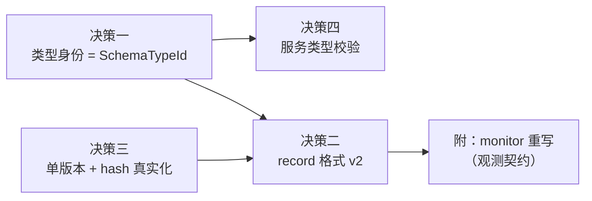

# 底层契约决策记录（P2 前置）

> 日期：2026-11-11
> 目的：P2 的六项里有四项是**契约级**改动（类型身份、schema 演进、录制格式、服务类型），会同时波及
> `TypedConstPtr`、transport 类型校验、record 格式、registry、codegen 五处。
> 本文件把需要先定的契约问题逐个展开：现状与证据、选项、建议、理由、收益、不决策的代价、影响面。
> 每条决策一旦确认，应同步进 `spec/` 与 `design_change.md`。

---

## 决策一：组件间消息的「类型身份」用什么

### 这是什么

两个组件通过通道传一条消息时，接收方必须回答一个问题：**"这条字节/指针，真的是我以为的那个类型吗？"**

当前实现（`basement/core/common_types.h:10-48`）：`TypedConstPtr` 内部存三样东西——

```cpp
std::shared_ptr<const void> ptr;   // 数据
const std::type_info* type;        // C++ RTTI 类型信息
const char* type_name;             // mangled 名字字符串
```

`as<T>()` 先比较 `typeid`，不等再 `strcmp` mangled name（`:34-47`）。

### 为什么是问题（四条，逐条有证据）

1. **跨 DSO 没有标准保证**。C++ 标准只要求"同一类型的 `typeid` 相等"，但主流实现按 `type_info` 对象地址比较；`-fvisibility=hidden` 时不同 DSO 会拿到不同地址。当前靠 `strcmp(name())` 兜底（`common_types.h:41`），把正确性押在 Itanium mangled name 的跨 DSO 一致性上。
2. **换编译器/标准库即失效**。clang 的 mangled name 与 gcc 不同（如 `std::__1::` 前缀），两套插件混用会**错误强转**而不是安全返回空。
3. **ODR 违规变成错误强转**。两个 DSO 各定义了一个同名但不同的类型（历史上有过：`astar.h`/`dijkstra.h`/`bellman_ford.h` 共用同一个 include guard），mangled name 相同 → `strcmp` 相等 → 错误强转 → 把 A 类型的字节当 B 类型读。
4. **payload 生命周期绑在生产者 DSO 上**。`shared_ptr` 的 control block 由创建方 DSO 实例化；`DlHandle` 析构会 `dlclose`（`component_dl_helper.h:35-43`），此后析构会跳进已卸载的代码。`type`/`type_name` 裸指针同样指向生产者 DSO 的静态存储。

### 选项

| 选项 | 做法 | 取舍 |
|---|---|---|
| A. 维持现状 | 依赖 mangled name + 人工纪律 | 零改动；插件生态与跨编译器场景 correctness 靠运气 |
| B. **SchemaTypeId 作为唯一身份** | `TypedConstPtr` 增加 `schema::SchemaTypeId{name, version, hash}` 字段；`as<T>()` 改为先比 TypeId；`typeid` 降级为 debug 断言 | 类型身份来自 schema（本就是系统的类型源）；跨 DSO 稳定（纯值比较）；跨语言可行 |
| C. 完全去 RTTI | 手写 tag + 工厂 | 与 B 等价但多一套机制，无额外收益 |

### 建议：B

### 理由

- **类型源唯一**。系统已经有 schema 作为"唯一类型源"的硬约束，消息类型身份理应从 schema 来，而不是从编译器 RTTI 来。现在等于有两套类型系统并行（schema 管字节、RTTI 管指针），它们不一致时没有报错点。
- **纯值比较跨 DSO 稳定**。`SchemaTypeId` 是三个标量字段，比较不依赖任何进程内地址。
- **是跨语言的前置条件**。将来任何 Python/Rust 组件不可能提供 C++ `type_info`。
- **改动是加法**：`as<T>()` 增加一次 TypeId 比较，现有按 `typeid` 的路径降级为 debug 断言，不破坏现有组件。

### 收益

- 插件生态成立：不同 DSO 编译的组件之间类型判断可靠
- ODR 类错误从"错误强转读脏数据"变成"类型不匹配、消息被拒并可诊断"
- 为跨语言组件（P2 之后）扫清第一个障碍

### 不决策的代价

每新增一个插件 DSO，类型误判风险增加一分；且这种错误的表现是"读到撕裂数据/字段错乱"，定位成本极高。

### 影响面

`common_types.h`（加字段）、`component.h`（类型不匹配时校验 TypeId）、生成代码（`.s.h` 的类型已带 `schema_type_id()`，可直接填入）。预估 1 天 + 回归。

---

## 决策二：录制要记什么，才配叫「可复现」

### 这是什么

`spec/system_vision.md` §4.3 与 `basement_tools.md` §5 把验收定为"**回放与线上一致（同版本、同参数、同输入）**"。当前 STARREC 格式（`message_recorder.h:17-68`）每条只记：

```
timestamp(i64, steady_clock) + channel(string) + type_name(string) + payload(bytes)
```

对照验收标准逐项检查：

| 验收要求 | 是否满足 | 缺什么 |
|---|---|---|
| 同输入 | 部分 | 只有 payload 本身；不记 QoS、丢帧、序列号 |
| 同参数 | **否** | 参数/配置快照完全不入录制文件 |
| 同版本 | **否** | 只记 `type_name` 字符串，不记 SchemaTypeId（version/hash），schema 演进后旧文件无法判断按哪版解码 |
| 时钟 | 部分 | steady_clock 纳秒（`native_message_bus.h:223-229`）：同机同 boot 可比，**跨重启/跨机器无意义**，没有 wall-clock 锚点 |

另有一个刚发现的事实：**`star monitor` 监控的是它自己**。`app.cc:618-645` 的 `monitor` 创建了一个全新的 `RuntimeContext`——新进程、新总线、零通道，所以永远输出 `(no topics registered)`。它根本连不上正在运行的系统：统计是各 worker 进程的内存对象（`ChannelStats` 在 bus 实例里），没有任何跨进程暴露机制。这意味着观测闭环的入口实际不存在。

### 选项

| 选项 | 做法 | 取舍 |
|---|---|---|
| A. 明确降级承诺 | 文档写死"录制仅限同机同 boot、同版本调试用途"，格式不动 | 零改动；"可复现"从验收标准里删掉 |
| B. **格式 v2：最小可复现集** | 文件头加：格式版本、wall-clock 锚点、每条加 `SchemaTypeId`（version+hash）；文件尾加参数快照通道 | 录制文件自描述；跨版本可诊断 |
| C. 完整可复现 | B + 全量参数/配置快照、QoS、丢帧记录、时钟域标识 | 工作量大；部分能力（QoS 记录）依赖 P1 已修的统计 |

### 建议：B（并明确"不支持跨版本回放"写进 spec）

### 理由

- **B 是"自描述"与"工作量"的平衡点**：格式 v2 只动 `message_recorder.h`（写）与 `message_replayer.h`（读）两个文件，各约 50 行；C 需要参数快照机制先存在（当前参数服务只有 get/set/list，没有"导出全量"）。
- **"不能跨版本回放"必须显式化**。现在的事实是：旧录制文件按当前 schema 盲解，结果要么静默错、要么抛异常，用户无法区分"数据坏了"和"schema 变了"。给每条记 TypeId 后，至少能报"这是 v3 时代的数据"。
- **monitor 的修复依赖这个决策**。如果观测走"共享内存统计段"，那统计段格式也是契约；如果走"工作者发布统计通道"，那统计通道也要录/不录的决策。先定观测契约，monitor 才能一次修对。

### 收益

- 录制文件自描述：拿到任何一份 `.starrec` 都能知道它属于哪个版本、参数是什么
- 回放器可以校验：schema 不匹配时明确报错，而不是静默解错
- monitor 有机会做成真的：观测走 shm 统计段或统计通道后，`star monitor` 才能连上运行中的系统

### 不决策的代价

录制/回放继续是"演示可用、实战不可用"；每次 schema 演进都会让存量录制文件变成不可诊断的垃圾。

### 影响面

`message_recorder.h`、`message_replayer.h`、`native_message_bus.h`（写入口带 TypeId）、`record_replay_tool`；monitor 重写单独列（见下）。

---

## 决策三：SchemaRegistry 要不要支持同 name 多版本共存

### 这是什么

`SchemaRegistry` 当前行为（`schema_registry.h:22-37`）：

- 同 TypeId 重复注册：**静默返回**（第一个赢）
- 同 name 不同 TypeId：**抛异常**
- 无 unregister / 无版本枚举

这意味着：生产者想发 v2、消费者还在读 v1，是不可能的——registry 在启动期就拒绝了。而真实的滚动升级场景（A 进程已升级、B 进程还没重启）恰恰需要两个版本短暂共存。

### 为什么现在"没炸"

因为全仓 schema 的 `version` 基本写死 0/1，`hash` 全是手写 0（`schema_codegen.py:442-447` 只把字面量写进去，全仓没有计算 hash 的工具）。版本号与哈希**只是装饰**，真正生效的是 name 字符串 + 人工纪律（改 schema 时全量重编、全量重启）。

### 选项

| 选项 | 做法 | 取舍 |
|---|---|---|
| A. **明确单版本** | registry 保持现状；把"升级必须全量重启"写进 spec 与 README；**补上 hash 计算与 lint 检查**（改 schema 忘改 hash 就 FAIL） | 承认边界，消除"看似支持实则不支持"的错觉；改动小 |
| B. 支持多版本共存 | registry key 改为 `name+version`；transport 校验放宽为"消费者声明可接受的版本集合" | 滚动升级可行；但 transport 校验、codegen、record、monitor 全要跟着改，且需要 schema 兼容性矩阵 |
| C. 双注册过渡 | 新旧版本同时注册，通道按 TypeId 路由 | 折中；仍需 B 的大部分机制 |

### 建议：先 A（现在），把 B 挂到路线图

### 理由

- **当前没有消费者需要多版本**。业务模块只有 4 个示例，全量重启的代价接近零。B 的全部复杂度是为"未来"付的，而未来什么时候来、来不来，未定。
- **A 不是什么都不做**：hash 计算缺失是实打实的洞——compat 工具能拦"改字段 id"，但拦不住"忘了更新 hash"，而 hash 一旦真的被用来做版本协商，全 0 的 hash 会让协商永远通过。补 hash 计算（codegen 对 descriptor 内容做确定性哈希）+ lint 检查（hash 与内容不符即 FAIL），是把"装饰"变成"真实机制"的最小一步。
- **B 的复杂度应该在有第一个真实需求时再付**，而且 B 依赖决策一（TypeId 身份）与决策二（record 带 version）先行。

### 收益（A）

- hash 从装饰变成可验证的机制：CI 拦"改了 schema 忘了同步 hash"
- spec 写明升级语义，消除"看似支持多版本"的错觉
- 为将来 B 留好了口子：TypeId 三要素已经在了，B 只是改 key 与校验策略

### 不决策的代价

维持现状的"薛定谔支持"：文档与代码结构暗示支持多版本，实际一跑就抛异常；hash 全 0 的坑在真正用 hash 时才爆。

### 影响面

`schema_codegen.py`（hash 计算 + lint）、`schema_registry.h`（可选：重复注册从静默改为校验内容一致）、`spec/basement_schema.md`（写明单版本语义）。

---

## 决策四：服务端口要不要纳入类型校验

### 这是什么

通道（`readers/writers`）有完整类型校验链：conf 写 `type`/`msg_type` → plan 携带 → `declare_channel` 注册 `SchemaTypeId` → 写入时校验（`shm_message_bus.h:163-167`、`native_message_bus.h:194-196`）。

服务（`commands`）没有：`ServicePortPlan` 只有 `name`、`channel`、可选 `request_type_name`/`response_type_name`（均为字符串，`component_load_plan.s.h`），`ServiceDescriptor` 只有 `name`（`service_bus.h:13-15`）。请求/响应的类型正确性完全靠 handler 里的 `decode_typed_request<T>` 在运行时抛异常。

加上 P1-1 刚把跨进程 RPC 接通，服务的类型错配将从"同进程立刻抛"扩散为"跨进程 5 秒超时"（`shm_service_bus.h:22` 硬编码 5s），更难定位。

### 选项

| 选项 | 做法 | 取舍 |
|---|---|---|
| A. 服务端口纳入 schema 校验 | `commands` 块的 `type`/`ack_type` 解析出 `SchemaTypeId`，进 `ServiceDescriptor`；`ShmServiceBus` 在 envelope 里携带并在收发两端校验 | 与通道一致；改动集中在 service_bus 两处 |
| B. 维持字符串类型名 | 服务类型校验留给 handler | 零改动；跨进程错配 = 5s 超时 |

### 建议：A，但排在决策一落地之后

### 理由

- **一致性**：同一个系统里，通道有类型校验、服务没有，用户会踩而且猜不到为什么两套行为不同。
- **决策一是前置**：校验要比较 TypeId，而 TypeId 身份机制是决策一的产物。先做决策四会把字符串比较再实现一遍，然后决策一时重写。
- **成本可控**：`ServiceDescriptor` 加两个字段，envelope 已有 correlation_id 字段可扩展；`parameter_component` 是唯一服务提供者，改一个组件即覆盖。

### 收益

- 服务类型错配从"跨进程 5 秒超时"变成"启动时/调用时报类型不匹配"
- 服务调用进入录制的路径打通（决策二里 record 带 TypeId，服务 envelope 同理）

### 不决策的代价

跨进程 RPC 刚接通就带着"类型错配 = 5 秒超时"的体验；且服务是控制指令的入口（如未来的 reroute/regenerate 命令），错配在这条链路上比数据通道更危险。

### 影响面

`service_bus.h`（Descriptor 加 TypeId）、`shm_service_bus.h`（envelope + 两端校验）、`plan_builder.h`（type_name → TypeId 解析）、`parameter_component.h`（conf 补 type 字段）。

---

## 附：第五个发现 —— monitor 是自指的（建议单独立项）

`star monitor`（`app.cc:618-645`）创建了一个全新的 `RuntimeContext`：新进程、新总线、零通道。它输出的 `(no topics registered)` 与 `Declared channels: 0` 是**它自己**的状态——它从未连接过正在运行的系统。

**根因**：`ChannelStats` 是各 worker 进程内存里的对象（`ChannelState.stats`），没有任何跨进程暴露机制。monitor 与 worker 之间没有共享、没有通道、没有 socket。

**建议**：观测契约与决策二绑定。两条路线：

| 路线 | 做法 | 取舍 |
|---|---|---|
| 共享统计段 | 各 worker 的关键统计（每通道 hz/dropped/last_seq）定期写进一小块共享内存，monitor 读 | 无新通道；但要设计统计段布局与并发写 |
| 统计通道 | worker 周期性发布 `starletto.stats.<group>` 通道，monitor 订阅全部 | 复用现有 transport；monitor 自己也占带宽（很小） |

**建议**：统计通道路线——它复用已验证的 transport 与 P1-2 的录制能力，且 monitor 变成一个普通订阅组件，符合"业务不碰系统细节"的分层原则。

**收益**：`star monitor` 从"自指的空报告"变成真正的运行时观测入口；这也是决策二（可复现）的验证工具——没有观测，任何契约改动的回归都看不见。

---

## 决策之间的关系与顺序



建议顺序：**决策一（1 天）→ 决策三（半天）→ 决策二（1–2 天）→ 决策四（1 天）→ monitor 重写（1–2 天）**。
全部完成后，P2 的六项里只剩 codegen 拆 IR、线程模型两项，且都变成了局部改动。

每条决策确认后：更新 `spec/basement_design.md` / `basement_schema.md` 对应章节 + `design_change.md` 登记 + 本文件标记状态。
