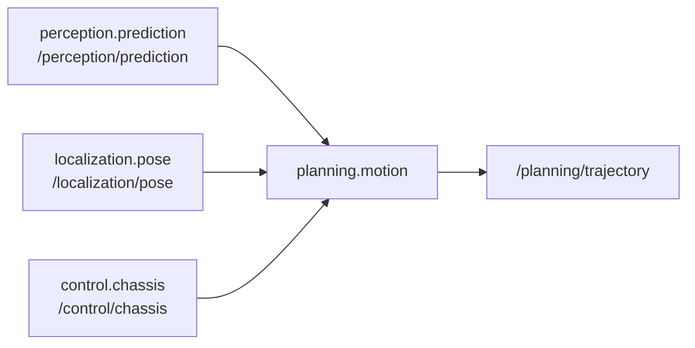

# planning.motion

规划示例组件，用来验证 runtime/transport 的装配、调度、录制闭环。
主 trigger 现在由三路**假上游节点**驱动，三路都到齐才跑一次：



## 端口

| 方向 | 端口 | 通道 | 用途 |
|---|---|---|---|
| 读 | `prediction` | `/perception/prediction` | 假预测目标 |
| 读 | `localization` | `/localization/pose` | 车辆位姿/速度 |
| 读 | `chassis` | `/control/chassis` | 底盘速度（优先于定位速度） |
| 写 | `trajectory` | `/planning/trajectory` | 轨迹（record=true） |

Trigger：`type = channel`，`readers [prediction, localization, chassis]`。

## 假上游

- [perception.prediction](../../perception/prediction/README.md)
- [localization.pose](../../localization/pose/README.md)
- [control.chassis](../../control/chassis/README.md)

它们只生成固定/正弦的合成数据，用于让 planning 与 control 闭环先跑起来；
不包含感知、定位或底盘算法。替换为真实模块时保持同名通道与 schema 即可。

## 资产

`frame/`、`machine/` 是规划数据模型与状态机骨架，当前未接线但按设计保留。

## 联调命令

```bash
./star run --frames=20 --sleep-ms=50 \
  modules/setting/config/component.conf \
  modules/setting/parameter/component.conf \
  modules/perception/prediction/component.conf \
  modules/localization/pose/component.conf \
  modules/control/chassis/component.conf \
  modules/planning/motion/component.conf \
  modules/control/pid/component.conf
```

静态部署同样命令加 `--static`。
